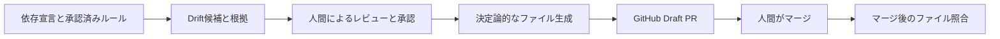

# RuleBranch

[](https://github.com/yunbow/rule-branch/actions/workflows/ci.yml)
[](./LICENSE)

**コードが変われば、ルールも育つ。**

RuleBranch は、GitHub リポジトリと開発ルールの不整合（Drift）を調べ、
根拠付きの改定案をレビュー・承認し、AI コーディング支援ツール向けの指示ファイルへ配布するアプリケーションです。
ルールの正本と変更履歴は Firestore で管理し、承認済みの内容を決定論的に生成して GitHub の Draft PR で配布します。

公開スナップショット: 2026-10-14

**現在の検出範囲:** 継続的な Drift 検知は、主に `package.json` の依存宣言と承認済みルールの比較を対象とします。
任意のソースコード変更や設計変更を網羅的に検知するものではありません。
初回のルール候補抽出と、継続的な Drift 検知は対象・目的が異なります。

## まず試す

公開 Web UI: [RuleBranch](https://rulebranch-web-fab7jjl4ta-an.a.run.app/)

| 方法 | 確認できること | 前提 |
| --- | --- | --- |
| [公開 Web UI](https://rulebranch-web-fab7jjl4ta-an.a.run.app/) | ログイン前のサービス説明・ログイン画面 | なし |
| 審査用の閲覧デモ（有効時） | Drift、承認待ち、反映状況、GitHub Draft PR の例 | 別途案内されるデモ用の認証情報。閲覧専用 |
| [ローカル UI](#ローカルで-ui-を確認する) | 固定 seed による画面・状態遷移の確認 | Node.js、Firebase CLI、Firestore Emulator |
| [実際の解析・GitHub 連携](./docs/usage/gcp-deployment.md) | GitHub の解析から PR 配布までの実経路 | ログイン、GitHub App、対象 Repository、Google Cloud の設定 |

審査用デモの入口が表示されるかどうかは、公開環境の設定によります。デモの認証情報は README では公開しません。
ローカル seed は UI 状態を再現する**固定データ**であり、実際の AI 呼び出しや解析精度を実証するものではありません。
GitHub ログインだけでリポジトリが自動連携されることもありません。

## 解決すること

開発ルールは設計資料、レビュー、過去の判断、`AGENTS.md` などに分散し、依存関係の更新に追従できなくなることがあります。
RuleBranch は、発見から配布までの判断履歴を一続きで扱います。

1. **変化を確認する:** リポジトリと承認済みルールを比較し、不整合の候補と根拠を示します。
2. **改定案をレビューする:** 人間が検出候補の採否を判断し、更新するルールの本文・差分・根拠・影響を確認します。
3. **承認済みルールを生成する:** 承認された版だけを、同じ入力から同じ結果になる変換処理（compiler）で各ツールの指示ファイルに変換します。
4. **Draft PR で配布する:** 人間が変更内容を確認し、GitHub でマージします。
5. **反映を照合する:** default branch のファイルを Git blob SHA で照合し、配布した生成物との一致を検証します。



### 例：依存関係の更新を次の開発ルールへ引き継ぐ

Zod 3 から Zod 4 への移行を題材に、古い入力検証規約の見直しを想定します。

1. `package.json` の依存更新をきっかけに、承認済みルールとの矛盾を確認します。
2. 人間が根拠と改定案を確認・承認します。
3. 新しいルールを `AGENTS.md` などの更新 Draft PR として配布し、マージします。
4. 次の開発で、更新された指示ファイルを開発環境へ取り込み、AI が新しい規約を参照することと、生成したコードのテスト結果を確認します。

**承認だけで、次のAI開発セッションに自動反映されるわけではありません。**
RuleBranch が確認するのは配布ファイルの状態です。開発 AI がルールを正しく守ったかは、実装・テストで別途検証します。

詳しい再現手順は [Zod 3→4 のE2E検証設計](./docs/demo/zod-upgrade-e2e-design.md) を参照してください。
この例は**検証設計**であり、実環境での成功実績を示すものではありません。

## 開発ルールと根拠の管理

ルールは、抽象度に応じて L1（理念）、L2（判断基準）、L3（具体的なガイドライン）に分けます。
さらに、適用範囲（組織または Project）と強制度を別々に扱い、継承、上書き、deny を解決します。
RuleVersion、evidence、Drift finding、承認、判断記録、生成物を関連付けることで、
「何を変えたか」だけでなく「なぜ変えたか」を追跡できます。

コード、設定ファイル、ルール本文、根拠の抜粋は、解析対象の題材データです。
AI を使う処理では、必要な範囲が RuleBranch のサーバーと設定された AI provider に送信されます。
ブラウザ内だけで処理が完結する構成ではありません。

## AI を使うところ、使わないところ

Worker は `google-genai` を使い、Gemini API または Vertex AI を設定できます。
Google ADK は依存関係に含まれますが、自律的な runner が処理全体を統括する構成ではありません。
AI はコードからのルール候補、Drift、改定案などを構造化された候補として返します。

次の処理はアプリケーションコードが担います。

- 権限、Workspace と Project の境界、状態遷移の検証
- AI 出力の schema 検証と、引用されたファイル・範囲の再取得
- 承認済みルール集合の解決と決定論的なコンパイル
- Draft PR の作成条件、競合検知、マージ後の blob 検証

API エラー、schema 違反、根拠不足、入力の切り詰めや警告がある場合は、承認側へ進めず停止または人間確認へ戻します。
AI が返した説明や tool 解釈そのものの正しさは保証せず、検証できたファイル内容との一致を境界にします。

## 承認と AI 品質評価

通常の RuleVersion 承認は人間が行います。任意の自動承認は、allowlist 内で AI データ利用に同意した
Workspace の既存 Project ルールに限り、L3、semantic 評価、`default` / `advisory`、
`guideline` / `coding-style`、`clarify` / `refactor` などの低リスク条件をすべて満たす場合だけ候補になります。
初回採用、Drift の triage、Draft PR のマージは人間が行います。

任意の自動承認経路では Vertex AI の判定・grounding と Model Armor を利用し、
すべての評価条件を満たす場合にだけ承認します。
評価スコアは正答率ではありません。まず `shadow` で人間の判断と比較し、対象 Workspace を限定して運用します。

## プライバシーとセキュリティ

GitHub OAuth token と GitHub App installation token は AI provider に渡しません。
Firestore の client rules は直接アクセスを拒否し、サーバー側で tenant と権限を検証します。
Cloud Tasks から非公開 Worker への呼び出しには OIDC を使います。

データ保持期間や削除運用は、導入先の構成と運用方針を確認してください。
脆弱性の報告方法は [SECURITY.md](./SECURITY.md) を参照してください。

## 出力

Repository ごとに選択した配布先へ、承認済みルールから次のファイルを生成できます。

- `AGENTS.md`
- `CLAUDE.md`
- `.github/copilot-instructions.md`
- `.rulebranch/rules/L1|L2|L3/*.md`

既存の共有指示ファイルに対しては、次の **RuleBranch 管理区間だけ**を更新します。

```markdown
<!-- BEGIN RULEBRANCH MANAGED RULES -->
ここに承認済みルールが生成されます。
<!-- END RULEBRANCH MANAGED RULES -->
```

管理区間の外にある手書きの指示は維持します。既存ファイルや基準となる生成物（baseline）との整合、
管理区間のマーカー、Git blob SHA などの条件を満たさなければ上書きせず停止します。
初回導入時も Draft PR で既存指示との矛盾を確認してください。
詳細は [既存の AI 指示ファイルとの共存](./docs/usage/managed-instructions.md) を参照してください。

## 技術構成

- `apps/web`: Next.js 16、React 19、TypeScript。UI、GitHub OAuth、RBAC、REST API
- `apps/worker`: Python 3.12 以上。リポジトリ取得、上限付き AI 入力、ファイル生成、GitHub 公開と検証
- `contracts`: Web と Worker が共有する enum と上限
- `infra`: Google Cloud 用 Terraform
- `.github/workflows/ci.yml`: Web、Worker、Terraform、コンテナの CI

実行環境は用途に応じて異なります。

| 用途 | 必要なもの |
| --- | --- |
| ローカル UI・seed の確認 | Node.js 24 以上、npm、Git、Firebase CLI、Firestore Emulator を動かせる Java |
| Worker の開発・テスト | Python 3.12 以上（上記のローカル UI 確認だけなら不要） |
| 実際の解析・GitHub 連携 | Google Cloud、GitHub App など。[GCP 構築手順](./docs/usage/gcp-deployment.md) を参照 |

Firebase CLI・Java の具体的なセットアップと検証環境は [ローカル開発環境](./docs/usage/local-development.md) にまとめています。

## ローカルで UI を確認する

**ここで確認できるのは固定 seed による UI です。** Gemini・Worker・Cloud Tasks・GitHub App は不要です。
以下は macOS / Linux の shell 用です。Windows PowerShell での環境変数設定は
[ローカル開発環境](./docs/usage/local-development.md) を参照してください。

1. リポジトリを checkout し、ルートで Web の依存関係をインストールします。

   ```bash
   npm --prefix apps/web ci
   ```

2. **別の terminal** で Firestore Emulator を起動したままにします。

   ```bash
   firebase emulators:start --only firestore --project rulebranch-demo
   ```

3. Web 用の terminal で**ローカル専用**の環境変数を設定し、seed を投入して開発サーバーを起動します。

   ```bash
   export FIRESTORE_EMULATOR_HOST=127.0.0.1:8080
   export FIRESTORE_PROJECT_ID=rulebranch-demo
   export RULEBRANCH_SESSION_SECRET=local-dev-session-secret-change-me
   export RULEBRANCH_DEV_LOGIN=1
   npm --prefix apps/web run seed
   npm --prefix apps/web run dev
   ```

   seed は接続先の Firestore に書き込みます。**必ず Emulator が起動し、`FIRESTORE_EMULATOR_HOST` が設定されていることを確認してください。**
   この固定 secret と開発ログイン設定を本番で使用しないでください。

4. ブラウザで [http://localhost:3000](http://localhost:3000) を開き、**そのページの開発者コンソール**で次を実行します。
   `RULEBRANCH_DEV_LOGIN=1` は開発ログイン API を有効にするだけで、自動ログインはしません。

   ```js
   await fetch("/api/auth/dev-login", {
     method: "POST",
     headers: {
       "Content-Type": "application/json",
       "X-Requested-With": "RuleBranch",
     },
     body: JSON.stringify({
       githubUserId: "1001",
       login: "dev-owner",
     }),
   });
   ```

5. ログイン後、[seed の Workspace](http://localhost:3000/w/seed-workspaces-2) を開き、ルール、Drift、承認待ち、反映状況などの画面を確認します。

この基本構成では解析ジョブは Worker に自動配送されません。解析ジョブが `queued` のままでも想定どおりです。
実処理の動作確認には [GCP 構築手順](./docs/usage/gcp-deployment.md) を利用してください。
seed の段階別データ、開発ログインの詳細、トラブルシューティングは
[ローカル開発環境](./docs/usage/local-development.md) と [UI デモ手順](./docs/demo/ui-demo-runbook.md) を参照してください。

## ドキュメント

- [設計ガイド](./docs/design/README.md): プロダクト、構成、データ、ライフサイクル、AI 信頼境界
- [Web マニュアル](./docs/manual/README.md): 画面操作、レビュー、公開、日常運用
- [利用ガイド](./docs/usage/README.md): ローカル開発、GCP 構築、自動承認、生成ファイル管理
- [GCP 構築手順](./docs/usage/gcp-deployment.md)
- [自動評価・人間エスカレーション](./docs/usage/automatic-approval.md)
- [Zod 3→4 の E2E 検証設計](./docs/demo/zod-upgrade-e2e-design.md): ルール更新から次の開発への引き継ぎを検証する計画（実施結果ではありません）

## コントリビューション

開発環境、変更範囲別の検査、Pull Request の方針は [CONTRIBUTING.md](./CONTRIBUTING.md) を参照してください。

## ライセンス

このリポジトリは [MIT License](./LICENSE) で公開しています。
ブランド画像は本プロジェクト向けに生成し、リポジトリ内で派生サイズへ変換した素材です。
依存ライブラリには、それぞれのライセンスが適用されます。

Web は `package-lock.json` で依存関係を固定しています。Worker の直接依存は exact pin ですが、間接依存を完全に固定する lockfile はないため、インストール時期によって解決結果が変わる可能性があります。
