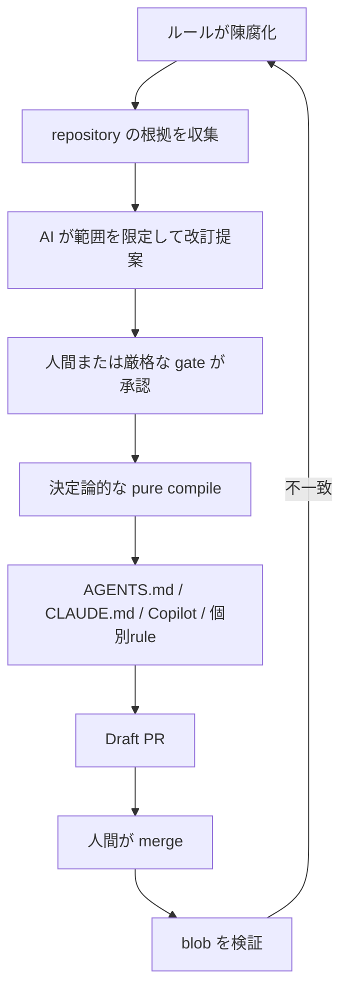

# 01. プロダクト概要

## 結論

RuleBranch の価値は、開発ルールを「書いて終わる文書」から、コード変更に追随して更新・配布・検証される運用資産へ変えることにある。
根拠を引用した AI 提案で保守コストを下げつつ、採用判断と GitHub merge は人間の作業として残す。

## 解く問題

| 現場の問題 | RuleBranch の答え | 実装上の意味 |
|---|---|---|
| ルールが README や設定へ分散する | Rule と版管理された RuleVersion に集約 | 本文と採用理由の履歴を上書きしない |
| コード変更で規約が古くなる | drift scan と finding | Project active と Rule stale を別管理 |
| 更新理由が残らない | evidence と rationale を版へ接続 | レビュー時に出典へ戻れる |
| AI ごとに設定形式が違う | 一つの解決済み集合から複数 target を compile | 手作業コピーを減らす |
| 自動生成物が勝手に公開される | Draft PR と human merge | GitHub が最終公開境界 |
| merge 後に人手編集される | Git blob SHA を再検証 | mismatch を新たな drift に戻す |

## 独自性

文書を一回生成する方式との設計上の比較では、RuleBranch は提案の前後も製品範囲に含める。

| 段階 | 単発生成 | RuleBranch |
|---|---|---|
| 入力 | 自由文 | repository evidence、現行版、関連ルール |
| 出力 | テキスト | provenance 付き proposed RuleVersion |
| 判断 | 暗黙 | role と状態遷移で明示 |
| 配布 | コピー | pure compiler から target 別 artifact |
| 公開 | 即時書き込み | Draft PR、human merge |
| 確認 | なし | default branch の blob verification |
| 履歴 | 会話依存 | 根拠と採用判断の履歴を永続化する |

## 中核となる利用シナリオ

1. ユーザーが GitHub App の repository を Project に接続する。
2. bootstrap が repository を読み、候補ルールと evidence を作る。
3. 人間が候補を確認し、初回ルールを採用する。
4. drift scan が依存宣言の変更と承認済みルールを比較し、意味上のずれを finding として示す。
5. 人間が finding を accept すると、AI が根拠付きの改訂案を作る。
6. 人間、または限定的な自動承認ポリシーが RuleVersion を承認する。
7. compiler が承認済みルールを各 AI ツール向けファイルへ変換する。
8. GitHub Publisher が Draft PR を作り、人間が merge する。
9. webhook 後の決定的な公開検証が default branch の生成物不一致を別の finding として返す。

## 判断と自動化の配分

| 判断 | 担当 | 理由 |
|---|---|---|
| repository から候補を抽出 | AI | 非構造テキストの意味理解が必要 |
| 初回ルールを採用 | 人間 | 組織意図の新規確立だから |
| drift を検出・説明 | deterministic check + AI | 機械判定と意味差分を併用 |
| finding を accept | 人間 | 対応すべき変化かは運用判断だから |
| 低リスク改訂を承認 | 人間、または任意の厳格 gate | 保守負担と統制の均衡 |
| 設定ファイルを生成 | pure compiler | 同じ入力なら同じ成果物にするため |
| PR を merge | 人間 | repository の最終変更権限を保持 |
| 公開結果を照合 | deterministic verifier | 期待 blob と実 blob を比較可能 |

## 自動承認の位置づけ

既定は `manual` である。
`shadow` は「条件を満たしたか」を記録して人間へ渡し、`auto` だけが限定的に承認状態を進める。
対象は明示 allowlist と AI データ利用同意がある Workspace 内の、
project-scoped L3、semantic、default/advisory、guideline/coding-style、clarify/refactor に限られる。
証拠不備、prompt injection 警告、関連状態の変化、評価 API エラーはすべて人間確認へ倒す。

実装: [approval-policy.ts](../../apps/web/src/shared/approval-policy.ts)、
[automatic-approval.ts](../../apps/web/src/shared/automatic-approval.ts)

## なぜこの形か

AI に repository write 権限まで与えると、提案品質と公開権限が一つの障害領域になる。
RuleBranch は「読む・提案する」「承認状態を変える」「成果物を計算する」「GitHub へ公開する」を分割した。
これにより AI モデルを変更しても、版管理、承認条件、生成結果の再現性を維持できる。

一方で、段階が増えるため単発の設定生成より操作は多い。
そのコストを job の非同期化、evidence の自動収集、複数 target の一括生成、Draft PR の再利用で回収する設計である。

## 実装根拠

- Rule lifecycle: [rules.ts](../../apps/web/src/shared/rules.ts)
- Drift と proposal: [drift.py](../../apps/worker/src/rulebranch/drift.py)、[proposal.py](../../apps/worker/src/rulebranch/proposal.py)
- Pure compiler: [compiler.py](../../apps/worker/src/rulebranch/compiler.py)
- Draft PR: [compile_job.py](../../apps/worker/src/rulebranch/compile_job.py)
- merge 検知: [github-app.ts](../../apps/web/src/shared/github-app.ts)
- blob 検証: [publish_verify.py](../../apps/worker/src/rulebranch/publish_verify.py)

## 限界

- ルールの正しさは組織の意図に依存し、AI の score は正解確率ではない。
- 自動承認の対象外となる初回採用、保護ルール、実行可能 check、曖昧な変更は人間レビューが必要になる。
- GitHub merge 後の外部 CI や各 AI 製品の解釈までは RuleBranch が保証しない。
- repository 規模、evidence 件数、AI 入力サイズには安全とコストのため上限がある。
