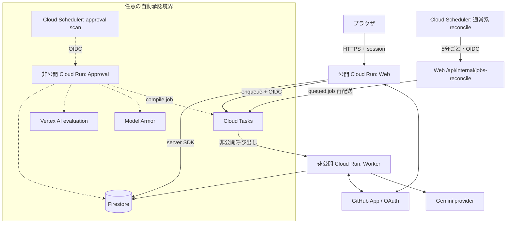

# 02. システム構成

## 結論

RuleBranch は公開 Web control plane、非公開 Worker data plane、Firestore、Cloud Tasks、GitHub App で構成する。
任意の自動承認だけを別の非公開 Cloud Run に隔離し、通常系の Web identity や browser session secret と分ける。

## コンポーネント責任

| 構成要素 | 所有する責任 | 所有しない責任 |
|---|---|---|
| Web | OAuth、session、RBAC、API、job 登録 | 重い repository 解析 |
| Worker | clone/read、AI 分析、compile、GitHub publish/verify | browser identity |
| Firestore | authoritative state、履歴、audit、job state | client-side direct access |
| Cloud Tasks | OIDC 付き配送、retry、backoff | job の業務状態 |
| GitHub App | repository token、webhook、Draft PR | RuleVersion の承認 |
| Approval service | allowlist 対象の定期評価 | 公開 Web session の発行 |
| Compiler | resolved input から artifact を計算 | storage、network、AI 判断 |

## 同期 control plane

Next.js Web は Firebase Admin 経由で Firestore を使い、起動時に domain service を構成する。
必要な Cloud Tasks 設定が揃う場合は `EnqueueingRuleStore` を使用し、
job document の作成後に task を発行する。
DB commit 後の enqueue 失敗は、通常系 Cloud Scheduler が5分ごとに
`/api/internal/jobs-reconcile` を呼び出し queued job を再配送する。
この復旧経路は任意の自動承認を有効にしない構成でも必要である。

GitHub OAuth は人の identity を確立し、GitHub App は installation 単位の repository access を担う。
同じ GitHub でも、login token を repository 操作へ流用しない。

実装: [bootstrap.ts](../../apps/web/src/server/bootstrap.ts)、
[auth.ts](../../apps/web/src/shared/auth.ts)、
[github-app.ts](../../apps/web/src/shared/github-app.ts)

## 非同期 data plane

Cloud Tasks payload は `workspaceId` と `jobId` に絞る。
Worker は payload を権威ある入力として処理せず、Firestore から job と Project を再取得する。
OIDC token は audience だけでなく、期待する service account email と `email_verified` も検査する。

Worker は job type ごとの専用 handler を登録する。

| job種別 | 主な処理 |
|---|---|
| bootstrap | repository から rule candidate と evidence を抽出 |
| drift_scan | 現行ルールと repository のずれを検出 |
| proposal | accepted finding から改訂候補を作成 |
| compile | 解決済みルールを生成し Draft PR を更新 |
| publish_verify | 現在の default branch HEAD の blob を期待値と照合 |
| purge | アンインストール／削除要求を処理。時間経過による retention purge は未実装 |

実装: [main.py](../../apps/worker/src/rulebranch/main.py)、
[job_runtime.py](../../apps/worker/src/rulebranch/job_runtime.py)

## AI 実行系の実態

依存関係には Google ADK が含まれるが、現在の実行エンジンを ADK Runner と表現するのは正確ではない。
`google-genai` を使う structured generator と、bootstrap、drift、proposal それぞれの専用 handler を組み合わせている。
コード側が repository の読み取りと prompt 準備を行い、役割別 agent adapter は準備済み prompt と schema を
Gemini に渡して JSON を検証する。LLM が SDK tool runner 経由で自律的に `read_file` を呼ぶ構成ではない。

設定は `gemini-api` と `vertex-ai` provider を受け付ける。
ただし repository の静的コードから現在の本番 provider を特定できないため、本番が一方だとは断定しない。

実装: [pyproject.toml](../../apps/worker/pyproject.toml)、
[config.py](../../apps/worker/src/rulebranch/config.py)、
[ai_runtime.py](../../apps/worker/src/rulebranch/ai_runtime.py)

## 任意の approval boundary

自動承認を有効にすると、同じ Web image を使う別 Cloud Run service が作られる。
この service は private、最大1 instance・concurrency 1で、専用 service account と専用 session secret を持つ。
Scheduler だけが OIDC で呼び出し、request body から Workspace、threshold、verdict を指定できない。

Model Armor はこの任意の approval evaluator の入出力 gate である。
通常の bootstrap、drift、proposal runtime 全体に常時適用されるものではない。

実装: [approval.tf](../../infra/approval.tf)、
[approval-api.ts](../../apps/web/src/shared/approval-api.ts)

## なぜ Cloud Run + Cloud Tasks か

| 選定 | 利点 | tradeoff |
|---|---|---|
| Cloud Run | Web と Python Worker を別 scaling / timeout にできる | cold start と platform 依存 |
| Cloud Tasks | OIDC、retry、rate limit、at-least-once 配送 | 冪等処理が必須 |
| Firestore | transaction と serverless 運用 | 複雑な join をアプリ側で組み立てる |
| GitHub Draft PR | 既存 review / branch protection を使える | merge は外部状態で非同期 |
| Pure compiler | 再現性と testability | 入力 snapshot を厳密に固定する必要 |

## 基盤の分離

Web、Worker、Scheduler、Approval は別 service account を持つ。
Web は Firestore と task enqueue、Worker は Firestore と必要 secret、
Approval は Firestore、Tasks、Vertex AI、Model Armor に限定した role を持つ。
secret payload は Terraform state に含めず、Secret Manager の version を Cloud Run へ注入する。

Firestore Security Rules は client read/write を全面拒否し、アクセスを server runtime に集約する。

実装: [main.tf](../../infra/main.tf)、[firestore.rules](../../firestore.rules)

## 限界

- Web の一部 integration は環境設定が不足すると構成されず、機能単位で利用不能になる。
- Firestore server SDK は強い権限を持つため、tenant isolation は各 service と RuleStore の検査に依存する。
- Cloud Tasks は exactly-once ではない。Worker と GitHub publisher の冪等性が正しさの一部である。
- 任意 approval service は Web image を再利用するため、deploy artifact は共有するが identity と ingress は分離する。
