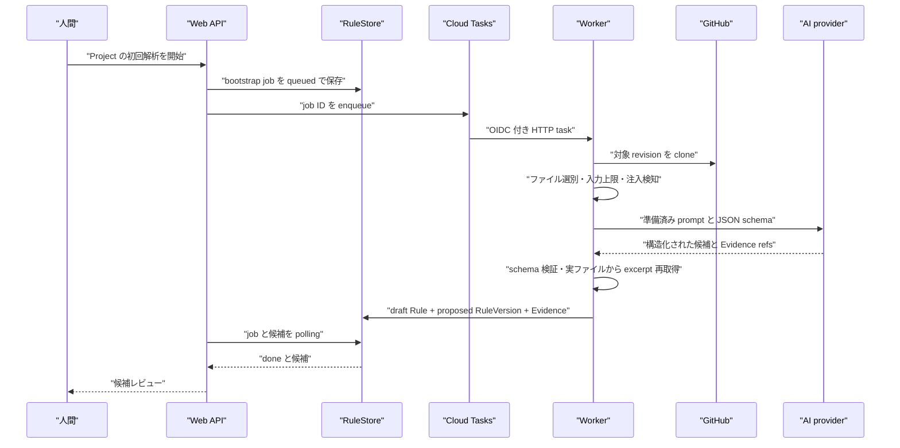
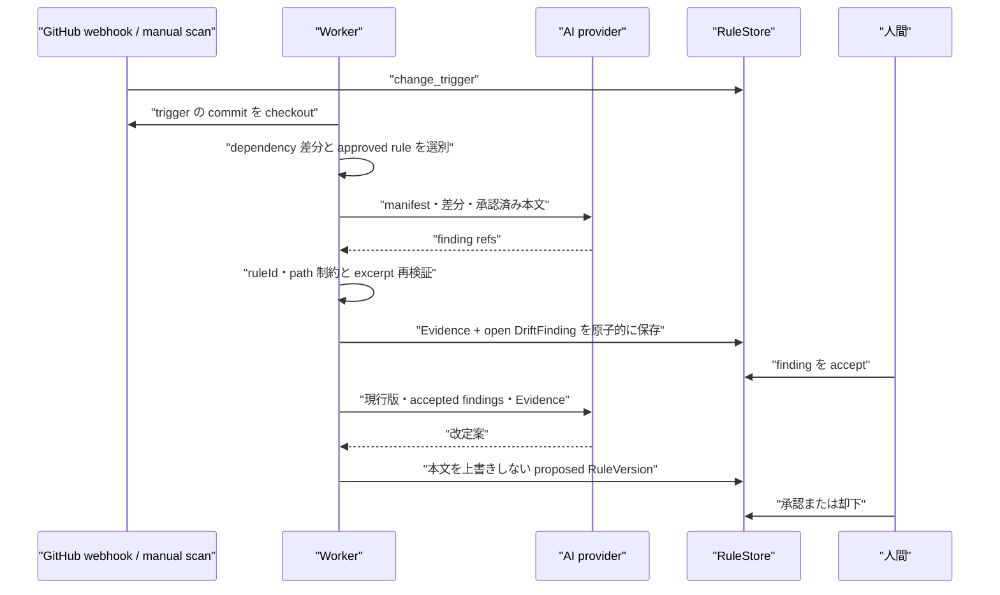
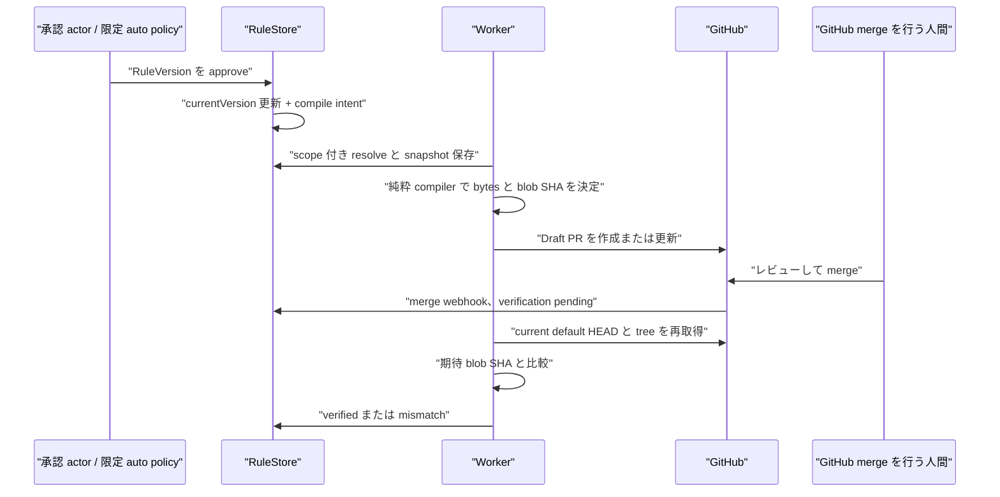

# データフロー

## 結論

RuleBranch は、AI の出力をそのままリポジトリへ書き込みません。コード側が取得した入力を AI に渡し、構造検証と実ファイルによる Evidence の再検証を行い、RuleVersion の提案として保存します。RuleVersion の本文、理由、互換性、Evidence 参照、版番号は版の内容として上書きせず、`status`、承認情報、`approvalReview` などのライフサイクル項目は遷移に伴って更新します。承認後はスコープ付き resolver と純粋な compiler が生成物を決め、GitHub には Draft PR として提示します。公開済みになるのは、人間によるマージ後に current default branch の blob を検証できた時です。

## 1. Bootstrap: Repository から初期候補へ

AI adapter は `google.genai` の構造化生成を呼びます。ADK の自律 tool runner は統合されておらず、`ReadOnlyAgent` の context や allowlist が SDK の tool 実行へ渡るわけではありません。Repository の読み取り、入力の切り詰め、Evidence の再取得は Worker コードが行います。[ai_runtime.py](../../apps/worker/src/rulebranch/ai_runtime.py#L61) [bootstrap.py](../../apps/worker/src/rulebranch/bootstrap.py)

## 2. Drift から改定提案へ

Drift scan は trigger を一度だけ処理し、AI が示した `commitSha` を信用せず、許可した manifest path の行だけを Evidence にします。proposal job は finding が `accepted` で、finding の基準版が現在の承認版と一致する場合だけ提案します。[drift.py](../../apps/worker/src/rulebranch/drift.py#L20) [proposal.py](../../apps/worker/src/rulebranch/proposal.py#L17) [rulestore.py](../../apps/worker/src/rulebranch/rulestore.py)

この図は trigger 作成後の分析部分に焦点を当て、Cloud Tasks の enqueue と OIDC 配送は省略しています。Job 配送境界は Bootstrap と同じです。

## 3. 承認から Draft PR、公開検証へ

承認トランザクションは compile 対象 Repository を durable intent として先に保存します。Worker は Repository ごとの lease を取得し、唯一の open Draft PR を更新します。Firestore に未記録の PR も GitHub から先に回収し、その PR の HEAD から既存 instruction を読み直して管理ブロック外を保持します。GitHub 書き込みは AI ではなく決定的 publisher が行います。clone 用認証も Worker 内にありますが、資格情報や書き込み能力はモデル入力へ渡しません。[rulestore.ts](../../apps/web/src/shared/rulestore.ts#L383) [compile_job.py](../../apps/worker/src/rulebranch/compile_job.py) [github_publisher.py](../../apps/worker/src/rulebranch/github_publisher.py)

この図も compile intent から Worker への Cloud Tasks 配送を省略しています。限定 auto policy が承認 actor になっても、GitHub merge actor は常に別の人間です。

## 状態ごとの意味

| 状態 | 確定していること | まだ確定していないこと |
|---|---|---|
| `proposed` | 上書きしない候補本文と根拠が保存済み | 採用、配布。status 等は遷移する |
| `approved` | 現行 RuleVersion として採用済み | GitHub への反映 |
| `draft_open` | 生成 bytes が Draft PR に存在 | default branch への反映 |
| `merged` + `pending` | GitHub がマージを通知 | 現在の default branch が期待 bytes か |
| `verified` | current default HEAD の対象 blob が一致 | 将来の手編集後も一致し続けること |
| `mismatch` | 対象 blob の不一致を検出 | 自動修復や自動マージ |

`approved ≠ published` です。複数 Repository 対象の版は、一部だけ検証済みなら `partially_published`、全対象で検証済みになって初めて `published` です。[rulestore.ts](../../apps/web/src/shared/rulestore.ts#L413)

## 決定性と再実行

| 境界 | 再実行時の仕組み |
|---|---|
| Job 作成 | idempotency key の一意予約 |
| Job 実行 | attempt owner と deadline、transaction 内 fence、terminal no-op、stale running lease、最大試行回数 |
| Drift | trigger の `processedAt` と原子的 batch |
| Proposal | job request ID の audit を commit marker として利用 |
| Compile | Repository lease と resolution snapshot |
| GitHub | 生成前に固定 head の open PR を回収、HEAD 再検査、回収済み PR は非 force 更新 |
| Verify | 最新 merged PR と current default HEAD の二重確認 |

根拠は [job_runtime.py](../../apps/worker/src/rulebranch/job_runtime.py)、[rulestore.py](../../apps/worker/src/rulebranch/rulestore.py)、[publish_verify.py](../../apps/worker/src/rulebranch/publish_verify.py) にあります。

## 実装範囲と限界

- Bootstrap、dependency drift、proposal、compile、Draft PR、merge 後 verify は実装済みです。
- drift の決定的 dependency 抽出は現在 `package.json` の dependency 群が中心です。他の manifest は webhook 検知対象でも同等の差分抽出を保証しません。
- `pr_review` と `impact` は contract の job type にありますが、production Worker registry に handler がありません。
- schema 不正時の専用 AI 再生成ループはなく、通常の job retry に入ります。
- verify は webhook の merge SHA をそのまま証明する処理ではありません。遅延中の追加 commit も含む current default HEAD を読み、保存直前にも HEAD が変わっていないことを確認します。
- Model Armor は任意の限定 auto-approval 系統の条件です。Bootstrap、Drift、Proposal の全 AI call を包む共通機構ではありません。
