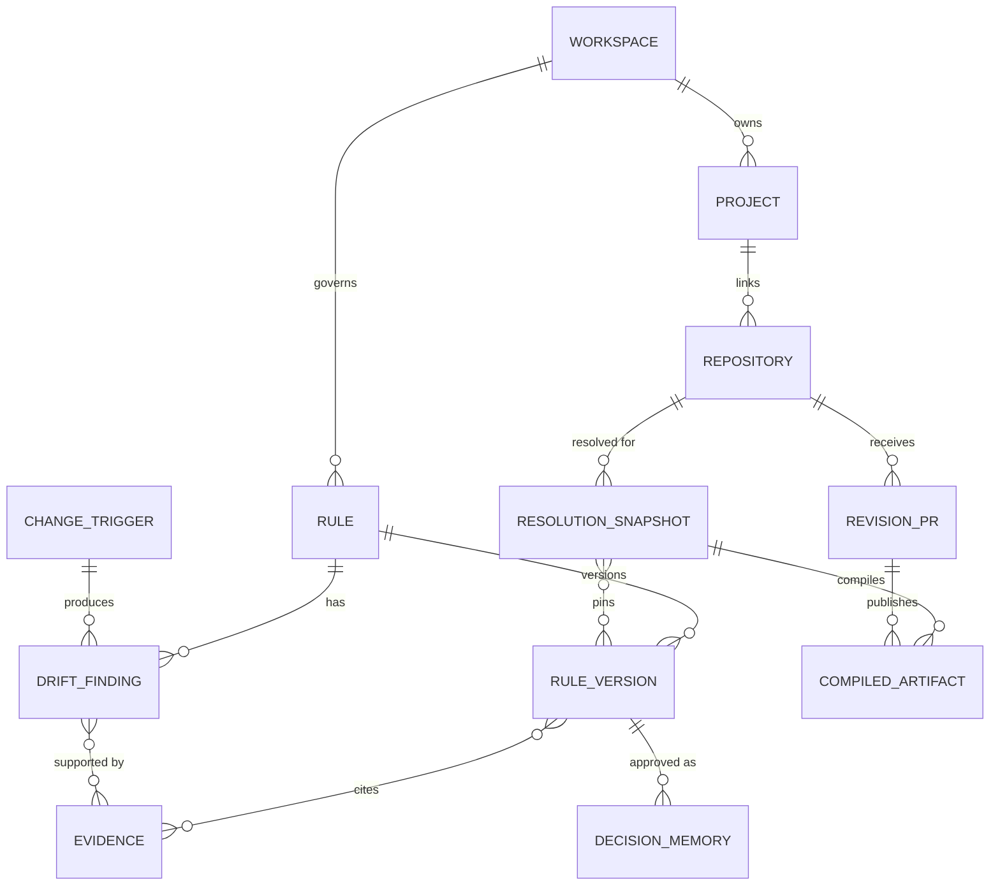

# データモデル

## 結論

RuleBranch の中心は、編集され続ける一枚の Rule 文書ではなく、Rule の識別子と RuleVersion の列です。各版の本文、理由、互換性、Evidence 参照、版番号は上書きせず、`status`、承認情報、`approvalReview` などは審査と運用に伴って更新します。Evidence、DriftFinding、ResolutionSnapshot、CompiledArtifact、RevisionPR を別 entity にすることで、「何を根拠に提案し、何を承認し、どの集合をどの Repository へ出し、実際に公開されたか」を後から分離して説明できます。

## 中核 ER

## Entity の責務

| Entity | 運用中に更新する項目 | 上書きしない内容・履歴上の役割 |
|---|---|---|
| `rules` | status、selector、maintenance、currentVersionId | key、scope、layer を持つ論理ルール |
| `rule_versions` | proposed から approved/rejected 等への状態遷移 | 本文、理由、互換性、Evidence 参照、版番号 |
| `evidence` | excerptState と purge metadata | commit/path/行、hash、出所 |
| `drift_findings` | open/accepted/resolved/dismissed | 発見時の ruleVersionId と Evidence |
| `resolution_snapshots` | なし | Repository ごとの順序付き ruleVersionIds |
| `compiled_artifacts` | verify 後の commitSha/publishedAt | snapshot、path、content hash、git blob SHA |
| `revision_prs` | draft/merged/closed、verification | PR、Repository、使用 snapshot |
| `decision_memories` | status | 承認理由と approved RuleVersion へのリンク |
| `analysis_jobs` | status、attempts、warning、error、開始・終了時刻、executionOwner、executionDeadline | 入力 payload、type、idempotency key。owner/deadline は試行ごとに更新する |

共通 enum は [contracts/enums.json](../../contracts/enums.json)、上限と遷移は [contracts/limits.json](../../contracts/limits.json) に集約されています。Worker は同じ JSON を [contracts.py](../../apps/worker/src/rulebranch/contracts.py#L8) から読みます。

## Rule と RuleVersion

Rule は現在採用中の版を `currentVersionId` で指します。AI proposal も人間作成版も、新しい `rule_versions` document を作り、既存本文を上書きしません。承認・却下・取下げでは状態や承認メタデータを更新します。版番号の割当、Evidence 保存、旧 proposal の withdraw、finding pointer 更新、audit は一つのトランザクションです。[rulestore.py](../../apps/worker/src/rulebranch/rulestore.py)

人間承認では、対象版を `approved`、旧 current を `superseded` にし、Rule の current pointer を進めます。同時に対象 DriftFinding を resolve し、DecisionMemory と compile intent を作ります。[rulestore.ts](../../apps/web/src/shared/rulestore.ts#L489)

この分離により、次を同時に保持できます。

- 過去に承認した本文と、その時点の Evidence
- 現在の本文と、未承認の次候補
- proposal が解こうとした accepted finding
- 各版が Repository ごとに公開されたかという導出状態

## Scope、Layer、Enforcement

| 軸 | 値 | 意味 |
|---|---|---|
| scope | organization / project / team / user | 所有・適用境界 |
| layer | L1 / L2 / L3 | L1 哲学・方針、L2 判断基準、L3 具体的ガイドライン |
| enforcement | locked / default / advisory / personal | 必須度と提示方法 |

これらは別軸です。`L1 = locked` や `L3 = advisory` ではありません。現行 UI の作成対象は organization と project で、organization は locked/default/advisory、project は default/advisory を扱います。scope は所有範囲、level は適用の強さを表します。

resolver は active/stale の organization と project Rule を Repository/selector で絞り、relation を適用します。`override` と `deny` は親を除外し、`extend` は両方を残します。出力は layer、enforcement、key、version ID の順で固定されます。[rulestore.py](../../apps/worker/src/rulebranch/rulestore.py)

## Snapshot と Publication

ResolutionSnapshot は、ある Repository に対して選ばれた RuleVersion ID の順序付き集合です。compiler は snapshot の順序を再ソートせず、外部 I/O、時刻、乱数を使いません。ただし決定性の条件は **完全な compiler 入力が同一であること** であり、保存 snapshot だけから過去の生成物を再現できるという意味ではありません。[compiler.py](../../apps/worker/src/rulebranch/compiler.py#L45)

RevisionPR の `ruleVersionIds` は起動契機の表示情報であり、公開状態の真実の集合ではありません。公開状態は RevisionPR が指す ResolutionSnapshot の `ruleVersionIds` から導出します。[rulestore.ts](../../apps/web/src/shared/rulestore.ts#L413)

| publication state | 導出条件 |
|---|---|
| `not_published` | 対象 Repository に verified snapshot も該当 open snapshot もない |
| `pr_open` | open Draft PR の snapshot に版が含まれる |
| `partially_published` | 対象 Repository の一部だけ latest merged が verified |
| `published` | 全対象 Repository の latest merged verified snapshot に版が含まれる |

### 決定性、再 compile、履歴再現の区別

| 項目 | 現在の保証・制約 |
|---|---|
| pure compiler | snapshot の順序、Rule/RuleVersion、適用 relation、Repository 設定など完全な入力が同一なら同じ bytes |
| 現在の再 compile | 現在の Rule、relation、compileTargets、rulesPath を読み直して解決する |
| 最終公開 blob | compiler 出力と既存 instruction file の管理ブロック外を合成した結果。同じ compiler 出力でも既存ファイルによって異なる |
| 保存 snapshot 単独による履歴再現 | 未保証。実行時 `resolvedRules`、deny 親版、当時の可変設定などは完全には保存していない |

過去の厳密な再現を実装する場合は、適用 relation、deny 親版、実効 enforcement、
Repository 設定、compiler/resolver version、合成元 blob を含む完全な入力記録が必要です。
現行の hash と CompiledArtifact は出力の照合用であり、この入力記録の代替ではありません。

集約 instruction の不一致は、その RevisionPR が指す snapshot の RuleVersion へ関連付けます。
最新 Rule の内容から過去の公開範囲を推測しません。原文の編集行から意味的に影響を特定するのではなく、
集約ファイル内の全採用ルールを保守的に対象とします。

## Governance fields

主要 entity は `ownerWorkspaceId`、scope、visibility、transfer policy、license、provenance、データ分類、retention、createdBy、timestamps を共有します。[contracts.py](../../apps/worker/src/rulebranch/contracts.py#L21) Store の読み取りは workspace context で絞り、別 tenant の存在を露出しない `NOT_FOUND` を基本にします。

Evidence は原文 excerpt と hash、commit/path/line を分けて保持します。データモデルは excerpt 削除後も参照メタデータを残せる形ですが、保存期間の経過で excerpt を purge する定期処理は未実装です。ただし自動承認は present な excerpt と一致 hash、40桁 commit SHA を要求します。[approval-policy.ts](../../apps/web/src/shared/approval-policy.ts#L94)

## 実装上の制約

- 一つの Repository につき open Draft PR は一件です。[rulestore.py](../../apps/worker/src/rulebranch/rulestore.py)
- Resolution は上限超過時に切り詰めず失敗し、不完全な snapshot を保存しません。[rulestore.py](../../apps/worker/src/rulebranch/rulestore.py)
- CompiledArtifact の大きな本文は Firestore から省略できますが、publisher には hash 算出時と同じ一時 bytes を渡します。[compiler.py](../../apps/worker/src/rulebranch/compiler.py#L20)
- personal enforcement は presentation 用で、生成 artifact から除外されます。
- Python Store は resolver/Worker path を担い、承認の本実装は Web/TypeScript Store にあります。両言語の interface が完全対称という設計ではありません。
- `team` は予約値で、現行 create API が明示的に拒否します。`user` は本人 scope の `personal` / `interaction` に限定され、resolver では Repository 生成物ではなく user 向け presentation に分離されます。[rules.ts](../../apps/web/src/shared/rules.ts#L43) [rulestore.py](../../apps/worker/src/rulebranch/rulestore.py)
