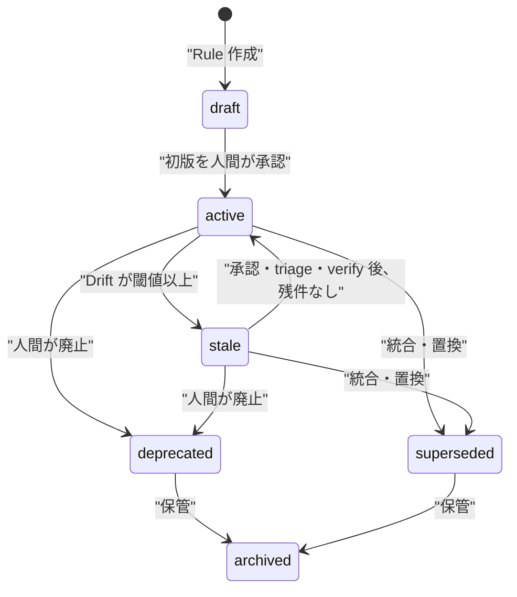
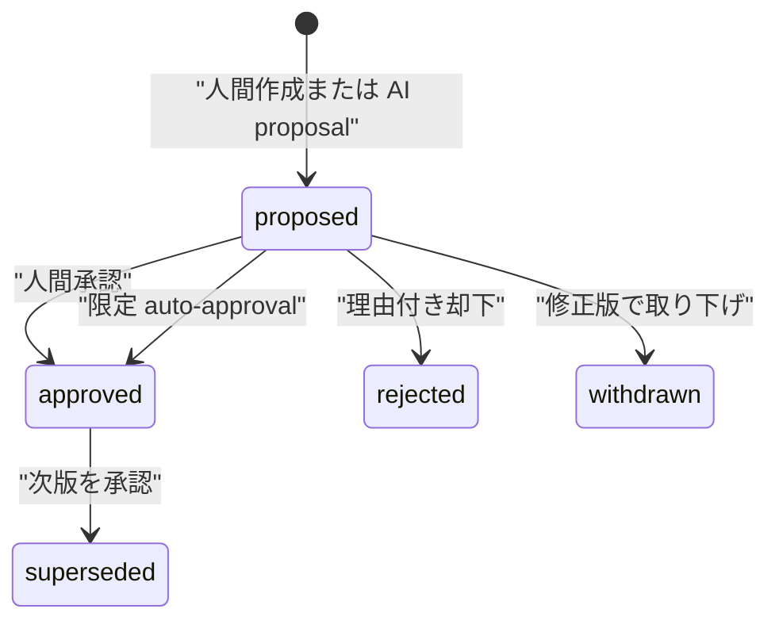
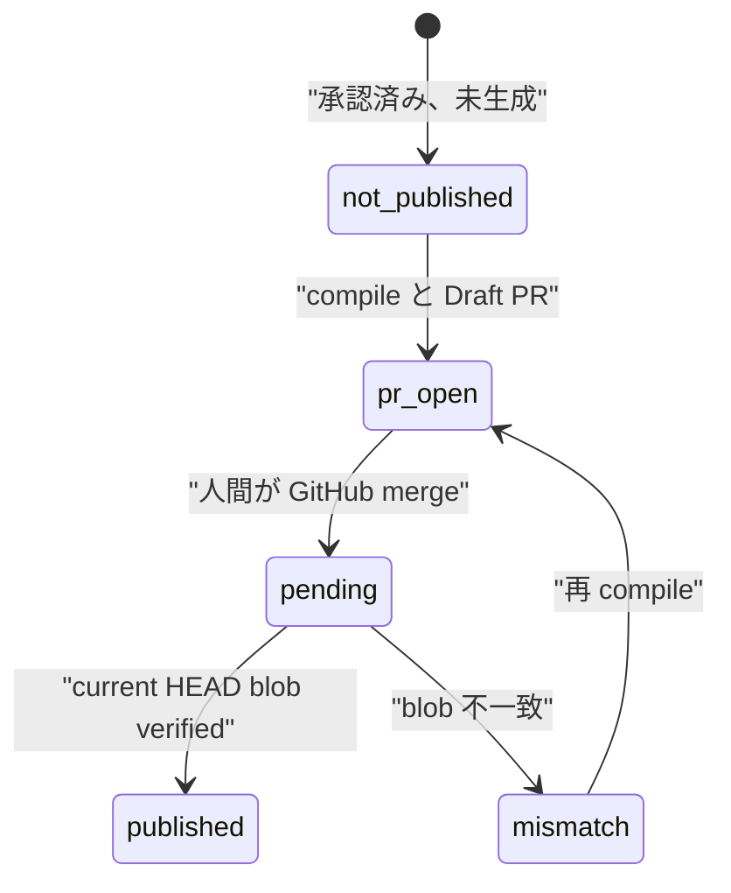

# Rule ライフサイクル

## 結論

Rule の運用状態と RuleVersion の審査状態は別々に進みます。AI は proposal を作れても Rule を直接採用できず、通常は人間が承認します。限定 auto-approval は既存 L3 の低リスク保守だけを対象にします。どちらの承認経路でも GitHub への反映は Draft PR で止まり、人間のマージと Worker の blob 検証が必要です。

## Rule の状態

`stale` は無効ではありません。resolver は `active` と `stale` を候補に含めます。medium 以上かつ confidence 0.6 以上の DriftFinding が stale を設定します。active へ戻す契機は、新版承認による linked finding の解決、finding の triage、artifact の再検証などです。その処理が Rule に残る open/accepted finding を再確認し、残件がない場合にだけ active へ戻します。confidence が下がっただけで自動復帰する遷移ではありません。[limits.json](../../contracts/limits.json) [rulestore.py](../../apps/worker/src/rulebranch/rulestore.py)

## RuleVersion の状態

本文などの版内容は上書きせず、上図の `status` と承認情報は審査に伴って更新します。

## 公開フロー

この図は一 Repository の流れを簡略化したものです。`pending` と `mismatch` は verification の状態を含む説明用ラベルで、RuleVersion の正確な publication state enum は `not_published` / `pr_open` / `partially_published` / `published` の4値です。公開状態は RuleVersion の `status` ではなく、ResolutionSnapshot、RevisionPR、verification から導出します。`approved` の直後に `published` になるわけではありません。

## 人間の判断が必要な境界

| 境界 | 通常経路 | 限定 auto 経路 |
|---|---|---|
| Bootstrap 候補の初回採用 | 人間が承認 | 対象外 |
| DriftFinding の accept/dismiss | 人間が判断 | 対象外 |
| RuleVersion の承認 | 人間が承認 | 適格な既存 L3 保守だけ可能 |
| Draft PR のレビューと merge | 人間が GitHub で実施 | 常に人間 |
| 公開検証 | Worker が決定的に実施 | Worker が決定的に実施 |

Human approval は actor を必須にし、版、Rule pointer、linked finding、DecisionMemory、audit、compile intent をトランザクションで更新します。[rules.ts](../../apps/web/src/shared/rules.ts#L137) [rulestore.ts](../../apps/web/src/shared/rulestore.ts#L489)

## 限定 auto-approval

自動承認は通常経路の代替デフォルトではありません。設定の既定は `manual` で、`shadow` は評価結果を表示しても proposal を承認しません。[approval-policy.ts](../../apps/web/src/shared/approval-policy.ts#L65)

適格性の主条件は次の通りです。

- allowlist 内で AI data usage consent を持つ active Workspace
- active Project の project-scope Rule
- L3、default/advisory、guideline/coding-style、semantic evaluation
- 初版ではなく、現行 approved 版がある active/stale Rule
- `clarify` または `refactor`
- accepted finding と版が変わっていない
- 完全で hash 検証可能な Evidence、入力 warning なし
- 関連 Rule の承認版が揃っている
- Judge、grounding、Model Armor の全閾値を満たす

条件の一つでも満たさなければ `human_required` です。評価 lease の期限切れ、context 変更、Worker 中断も安全側へ移します。[approval-policy.ts](../../apps/web/src/shared/approval-policy.ts#L94) [firestore-approval-repository.ts](../../apps/web/src/shared/firestore-approval-repository.ts#L71)

Model Armor はこの任意 approval evaluator の条件であり、base AI provider の全呼び出しに適用されるとは限りません。base provider は `gemini-api` または `vertex-ai` を選べます。[ai_runtime.py](../../apps/worker/src/rulebranch/ai_runtime.py#L61) 環境設定なしに、本番で auto approval、Vertex AI、Model Armor が稼働しているとは断定できません。

## L1/L2/L3 と enforcement

| Layer | 意図 | 自動承認 |
|---|---|---|
| L1 | 哲学・方針 | 対象外 |
| L2 | 意思決定基準 | 対象外 |
| L3 | 具体的ガイドライン | 上記の低リスク更新だけ候補 |

Layer は抽象度であり、強制度ではありません。enforcement は別に locked/default/advisory/personal を持ちます。organization の locked 親は override/deny できず、extend による強化は可能です。[rulestore.ts](../../apps/web/src/shared/rulestore.ts#L360)

## Drift と解決

1. GitHub push または manual review が ChangeTrigger を作ります。
2. Worker が approved RuleVersion と対象 commit の manifest を比較します。
3. 検証できた Evidence を持つ finding だけを open で保存します。
4. 人間が accept すると proposal job の対象になります。
5. AI proposal は accepted finding が指す同じ current version にだけ作成できます。
6. 提案版の承認は、その版が対象にした finding を resolved にします。
7. 別の open/accepted finding が残れば Rule は stale のままです。

この版固定により、queue 待ちの古い finding が新しい current Rule を書き換えることを防ぎます。[proposal.py](../../apps/worker/src/rulebranch/proposal.py#L25)

## Publication と再調整

compile は承認済み Rule を直接 default branch へ push せず、Draft PR を作成または更新します。人間が merge した webhook は RevisionPR を `merged`、verification を `pending` にし、`publish_verify` job を作ります。[github-app.ts](../../apps/web/src/shared/github-app.ts#L210)

verify は current default HEAD の tree と CompiledArtifact の git blob SHA を比較します。一致すれば `verified`、不一致なら `artifact_mismatch` finding と system Evidence を作ります。個別ルールファイルは対応する Rule を対象とし、`AGENTS.md`、`CLAUDE.md`、`.github/copilot-instructions.md` は公開 snapshot 内のルールへ保守的に関連付けます。関連付けた版が現在の承認版である Rule を stale にし、より新しい承認版へ過去の不一致を誤適用しません。[publish_verify.py](../../apps/worker/src/rulebranch/publish_verify.py)

集約ファイルは管理ブロック外も含む whole-file blob を照合するため、手編集領域だけの変更も mismatch になります。
再 compile はその領域を保持して期待 blob を更新できます。修復時は同じ Repository・対象 path の
artifact_mismatch finding だけを解決し、他 Repository の不一致や dependency drift が残る Rule は stale のままです。

集約ファイルが多数の Rule を含む場合、関連付けを50件で打ち切らず20件単位の transaction に分けます。
途中停止した mismatch 処理は、`findingsComplete` が記録されるまで再開対象です。
修復側も finding 解決と Rule 状態の再計算を bounded transaction に分け、`verified` を記録した後の
途中停止は再配送で再開します。

## 限界

- 自動承認の設定 UI はなく、外部運用設定が必要です。
- 自動承認後も merge は自動化されません。
- Draft PR を閉じたことは RuleVersion の却下を意味しません。
- merge webhook を受けても verify 前は published ではありません。
- 最新 merged PR 以外の遅延 verify は安全な no-op になります。
- Rule の archive/復活など全管理操作を Worker が担うわけではなく、Web service の human-authorized path もライフサイクルの一部です。
