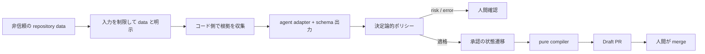

# 06. AI の信頼境界とセキュリティ

## 結論

RuleBranch は AI を「非信頼データを読み、構造化候補を返す部品」として扱う。
AI に承認権限や任意の write tool を渡さず、schema、provenance、RBAC、決定論的 gate、transaction、Draft PR を重ねる。

## 信頼境界

| 入力／主体 | 信頼水準 | 制御 |
|---|---|---|
| repository text | untrusted | delimiter、size bound、injection warning |
| AI model output | untrusted | JSON schema、enum、type validation |
| browser request | authenticated but untrusted | HMAC session、CSRF、RBAC、tenant scope |
| Cloud Task | machine-authenticated | Google OIDC audience + exact SA email |
| GitHub webhook | external authenticated | payload cap、HMAC signature、delivery dedupe |
| Firestore state | tenant 内の正本 | transaction、版管理、audit |
| compiler output | derived | content hash と Git blob SHA |

## repository 分析

コード側の repository reader は clone 済み directory の読み取りに限定される。
path traversal、symlink による clone root 外へのアクセス、サイズ超過を拒否し、
収集した入力を明示的に「命令ではなくデータ」として囲う。
検出した疑わしい命令は warning として job に残し、後段の自動承認対象から外す。

`ReadOnlyAgent.run` は準備済み prompt と schema を generator へ渡す adapter である。
execution context の tool allowlist を SDK tool runner に渡して LLM が自律的に file を読む構成ではない。
repository の取得と evidence 準備は handler / code が行い、Gemini は schema に沿った JSON を生成する。

AI は evidence reference を path と line range で返す。
Worker はその参照を実データへ materialize し、後の proposal と review が引用元へ戻れるようにする。

実装: [ai_runtime.py](../../apps/worker/src/rulebranch/ai_runtime.py)、
[bootstrap.py](../../apps/worker/src/rulebranch/bootstrap.py)、
[proposal.py](../../apps/worker/src/rulebranch/proposal.py)

## 書き込み権限の分離

用途別 agent adapter は proposal や finding の材料を返すが、モデル入力に credential や write capability を含めない。
handler が schema 検証後に domain invariant を適用し、RuleStore を通じて書き込む。

承認後も compiler は storage-free の pure function として artifact を計算する。
GitHub Publisher はその結果だけを branch / Draft PR にし、最終 merge は GitHub 上の人間に委ねる。

この分離により、prompt injection が成功して文章出力へ影響しても、
直接 approval、secret 取得、任意 repository write へ到達するモデル経路を持たない。
clone 処理自体は GitHub App の read token を保持するが、モデルとは分離される。
公開は検証済み artifact を扱う deterministic publisher path が担う。
Publisher は外部 I/O 前に実行 owner と compile lease を再確認するが、すでに送信済みの API request を
Firestore transaction と原子的に取り消すことはできない。遅延・不明応答は回収と verify の対象とする。

## 自動承認の追加 gate

自動承認は既定 `manual`、最大20の明示 allowlist、AI データ利用同意を前提とする。
候補は少なくとも次をすべて満たす必要がある。

| Gate | 条件 |
|---|---|
| scope | active Project の project-scoped L3 |
| semantics | semantic evaluation mode |
| protection | default/advisory、guideline/coding-style |
| change | clarify/refactor の保守更新 |
| history | 承認済み current version が存在 |
| evidence | 欠落なし、excerpt hash 一致、40桁 commit SHA |
| drift | accepted finding が同じ immutable version を参照 |
| safety | injection / truncation / unverifiable warning なし |
| consistency | context digest が評価開始時から不変 |

初回ルール、locked policy、security rule、実行可能 check、tighten/relax/deprecate、
根拠不足、関連状態の変化は人間確認へ進む。

実装: [approval-policy.ts](../../apps/web/src/shared/approval-policy.ts)、
[firestore-approval-repository.ts](../../apps/web/src/shared/firestore-approval-repository.ts)

## Model Armor と独立評価

Model Armor は任意の automatic approval path にだけ使う。
入力を Gemini へ送る前と、Gemini / judge / groundedness の応答を採用する前に検査する。
filter が未実行、設定不足、match、API error のいずれでも通過とみなさない。

評価は単一の「approve」という文章だけに依存しない。

1. Gemini structured judgement が APPROVE / LOW を返す。
2. evidence support、intent preservation、conflict、protection の boolean が一致する。
3. pointwise judge score が設定 threshold 以上である。
4. groundedness score が 1、confidence が threshold 以上である。
5. Model Armor の出力検査を通る。
6. commit transaction 内で同じ context digest を再確認する。

どれか一つでも失敗すれば `human_required` になる。
`shadow` mode は適格性を観測するだけで自動承認しない。

実装: [google-approval-review.ts](../../apps/web/src/shared/google-approval-review.ts)、
[automatic-approval.ts](../../apps/web/src/shared/automatic-approval.ts)

## identity と tenant security

user session は HMAC-SHA256 署名、24時間上限、timing-safe comparison を使う。
mutation は custom header、Origin、Fetch Metadata を検査する。
各 domain service は Workspace membership と role を確認し、document の `ownerWorkspaceId` を照合する。

GitHub OAuth は user identity 用、GitHub App installation token は repository 操作用に分離する。
Worker と Scheduler は browser cookie ではなく service account OIDC を使う。

実装: [auth.ts](../../apps/web/src/shared/auth.ts)、
[authz.ts](../../apps/web/src/shared/authz.ts)、
[request-security.ts](../../apps/web/src/shared/request-security.ts)、
[job_runtime.py](../../apps/worker/src/rulebranch/job_runtime.py)

## データの扱い

automatic approval は Workspace が AI データ利用へ明示同意した場合だけ、rule と evidence を Google 評価 API へ送る。
入力が上限を超える場合は切り捨てて評価せず、人間確認へ倒す。
automatic approval evaluator は provider response body や customer code を含み得る exception detail を
永続 log に保存しない。この記述は全 Worker handler のログ方針を保証するものではない。

AI provider 設定は `gemini-api` と `vertex-ai` をサポートするが、現在の本番設定値は設計文書で推測しない。

## 限界

- HMAC session は stateless で、個別 session の即時 revoke list は実装していない。
- custom header は単独で origin proof ではないため、browser が提供する Origin / Fetch Metadata と組み合わせる。
- server service account は Firestore へ強い権限を持つ。アプリ層の tenant check と監査が重要になる。
- Model Armor は任意 approval path の防御であり、すべての AI job に一律適用されるわけではない。
- AI データ利用に同意しない Workspace では automatic approval を行わず、人間 review を継続する。
