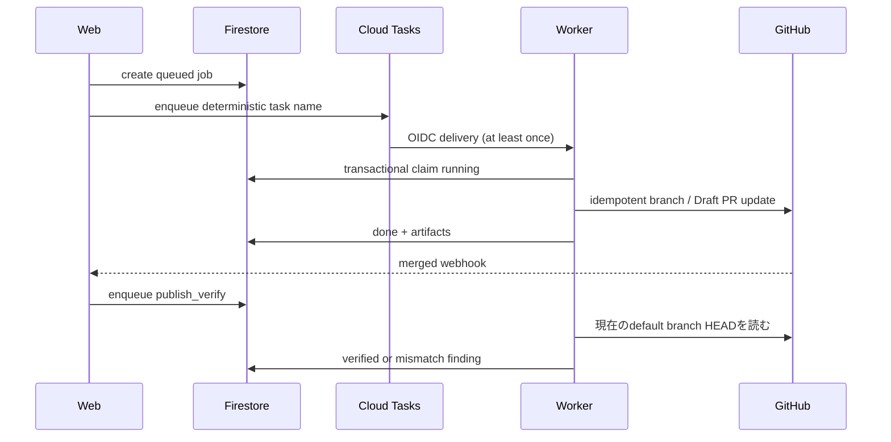

# 07. 信頼性と設計判断

## 結論

RuleBranch は exactly-once を仮定せず、Firestore の状態機械、idempotency key、lease、transaction、
Git blob hash を組み合わせて「再実行して収束する」ように設計する。
外部 side effect の途中失敗も、reconcile と verify で観測可能な状態へ戻す。

## 想定する障害

| 障害 | 設計上の応答 |
|---|---|
| job commit 後、task enqueue 前に停止 | 5分ごとの reconcile が queued job を再配送 |
| Cloud Tasks が二重配送 | terminal job は no-op、task name は job ID 由来 |
| Worker が running 中に停止 | 15分 lease 経過後、観測した attempt owner / startedAt と一致するときだけ回収 |
| 旧 Worker が遅延して再開 | transaction 内 owner fence と deadline が旧試行の書き込みを拒否。GitHub I/O 前にも所有権を検査 |
| compile が同じ repository で競合 | repository compile lease で直列化 |
| GitHub side effect 後、Firestore 更新前に停止 | 未記録の open PR を生成前に回収し、その HEAD から再生成。回収した PR に force 更新しない |
| approval 評価中に停止 | lease expiry を approval せず human_required へ変更 |
| 評価後に context が変わる | transaction 内 digest 比較で human_required |
| PR merge 後に内容が違う | blob mismatch finding を作る |

## job の耐久性

Web は先に `analysis_jobs` document を commit し、その後 Cloud Tasks へ enqueue する。
この順序により queue 障害でも依頼自体を失わない。
task name は job ID の SHA-256 から作り、`ALREADY_EXISTS` を成功相当として扱う。

Cloud Tasks の delivery retry と、application の handler failure count は別の budget である。
delivery は一時的な lease / network failure を吸収し、application state は一定回数で `dead` へ進む。

実装: [enqueueing-rulestore.ts](../../apps/web/src/shared/enqueueing-rulestore.ts)、
[analysis-jobs.ts](../../apps/web/src/shared/analysis-jobs.ts)、
[job_runtime.py](../../apps/worker/src/rulebranch/job_runtime.py)

## Worker の状態機械

Worker は task payload の job type や repository を信用せず、Firestore から job を読み直す。
`done` / `dead` は再配送時に即座に終了する。
最近開始した `running` は別 instance が所有中とみなし 503 で backoff させ、
lease を超えた `running` は一度 `failed` にしてから正規の遷移で再 claim する。
回収 transaction は観測した `executionOwner` と `startedAt` を比較し、
すでに別試行へ進んでいる job を回収しない。
claim で新しい `executionOwner` と `executionDeadline` を保存する。
Worker の各 RuleStore transaction は書き込み前に同じ transaction 内で job の owner を読み、
Firestore の競合検知に参加させる。期限切れ・owner 変更時に旧試行は結果や failure count を更新しない。

各 job は予測不能な `mkdtemp` directory を持ち、終了時に cleanup する。
document ID を filesystem path として直接使わない。

## compile と GitHub side effect

Compiler 自体は storage と network を持たない pure function である。
順序付き resolution snapshot と Rule、RuleVersion、relation、Repository 設定を含む完全な入力から artifact を計算する。
保存 snapshot はこれら可変入力すべてを保存するものではなく、snapshot 単独での履歴再現は保証しない。
content hash と Git blob SHA を同時に生成し、同じ入力の再計算を比較可能にする。

Compile job は Repository lease を取得し、Firestore に open PR がなければ GitHub 上の未記録 PR を先に回収する。
その後で回収した PR の HEAD と blob を読み、生成内容を準備する。公開処理の途中で別の open PR を発見した場合は、
その場で branch を初期化せず、再 compile に戻す。回収した PR は非 force 更新とし、書き込み前にも HEAD を再確認する。

共有 instruction file では RuleBranch 管理ブロック外の内容を保持し、ブロック内は生成物として置換する。
blob hash の検査は読み取った bytes の整合性確認であり、管理ブロック内の手編集を一律拒否するものではない。
管理マーカーの不正や、前回 artifact の hash で所有確認できない旧形式ファイルを検出した場合は公開を停止する。

GitHub I/O 前にも attempt と compile lease の所有権・期限を確認する。
ただし Firestore と GitHub に共通の原子的な fence はない。すでに送信済みの HTTP request の取消しや
厳密な exactly-once は保証せず、不明な応答は PR 回収と後続 verify で調整する。
固定 branch は RuleBranch 専用とし、新規 PR の準備時に残存 branch を初期化する経路と、
既存 PR を回収して非 force 更新する経路を区別する。

実装: [compiler.py](../../apps/worker/src/rulebranch/compiler.py)、
[compile_job.py](../../apps/worker/src/rulebranch/compile_job.py)、
[github_publisher.py](../../apps/worker/src/rulebranch/github_publisher.py)

## 公開後の検証

PR merge webhook はイベントの commit SHA を記録し、`publish_verify` job を起動する。
ただしその SHA は起動の手掛かりであり、照合対象そのものではない。
verifier は最新の merged snapshot だけを対象に、検証時点の default branch HEAD を取得し、
artifact ごとの期待 `gitBlobSha` とその HEAD の実 blob SHA を比較する。
tree の取得中に HEAD が移動した場合は結果を保存せず、job を retry して新しい HEAD を読み直す。
一致すれば artifact を published として記録し、不一致なら evidence、trigger、finding を作る。
集約 instruction file の `ruleId = null` を理由に finding を省略せず、公開 snapshot 内の版に関連付ける。
多数の関連付けは20件ずつ保存し、全 batch の完了を `findingsComplete` で記録する。
完了前の mismatch は再配送で再開し、既存の open/accepted finding を再利用する。
修復は同一 Repository・path の finding だけを bounded batch で解決する。`verified` の記録を再開点とし、
途中停止した場合も再配送で未解決分と Rule 状態の再計算を続ける。

これにより公開は「PR を作れた」ではなく、「merge 後の repository に期待 blob がある」まで追跡される。

実装: [github-app.ts](../../apps/web/src/shared/github-app.ts)、
[publish_verify.py](../../apps/worker/src/rulebranch/publish_verify.py) の `PublishVerifyJobHandler.__call__` が、
event SHA ではなく HEAD を取り直し、HEAD 移動時に retry する処理を示す。

## 承認 transaction

automatic approval は評価前に lease 付きで proposal を claim する。
評価対象 context の canonical digest を作り、完了 transaction 内で全 document を再読して比較する。
期限切れ、context change、source job warning、API error は approval へ進めない。

承認 transaction は旧版 supersede、新版 approve、Rule current pointer、finding resolution、
decision memory、audit log をまとめて更新する。
compile job の発行意図は `compilePending` と対象 repository IDs として永続化し、
dispatch に失敗しても次回 scan で再試行する。

実装: [firestore-approval-repository.ts](../../apps/web/src/shared/firestore-approval-repository.ts)

## 主な設計判断と tradeoff

| 設計判断 | 理由 | コスト |
|---|---|---|
| RuleVersion の本文・採用理由を版管理 | review 対象と evidence を固定。status、approvalReview、承認情報は更新される | document 数が増える |
| Firestore transaction | tenant / version / audit を原子的に更新 | query と write 順序に制約 |
| outbox-like flags | DB commit と queue の二重書きを回復 | reconcile 処理が必要 |
| Draft PR reuse | retry で PR を乱立させない | GitHub 現在状態の読取が必要 |
| blob-level verify | 表示や commit message に依存しない | merge 後に追加 API call |
| bounded concurrency | downstream と費用を制御 | 大量 batch の完了に時間 |
| fail-closed approval | 不確実性を人間へ戻す | 自動化率は下がる |

## 容量に関する判断

Worker は最大5 instance、instance concurrency 1、request timeout 600秒で、
Cloud Tasks も秒5件・同時5件に合わせる。
Cloud Run の HTTP timeout はコンテナやアプリケーション処理の停止を保証しない。
本番 Worker は540秒のアプリケーション deadline を持ち、watchdog が期限到達時にプロセス終了を要求する。
加えて transaction 内と外部 I/O 前に期限・所有権を検査し、OS のスケジューリングや HTTP timeout だけに依存しない。
`540秒（アプリ） < 600秒（HTTP） < 900秒（回収lease）` は復旧の余裕であり、これ自体が排他の証明ではない。
watchdog の強制終了では一時ディレクトリ cleanup が完了しない場合がある。Firestore の durable state は後続配送で回収する。

**導入時は旧 Worker revision を停止し、旧実行が残っていないことを確認する。**
旧コードは新しい owner fence を検査しないため、無停止の混在 rollout では新コードの保証を旧試行へ適用できない。
HTTP timeout 待ちだけを旧処理の停止確認に使わない。

公式の timeout の意味: [Cloud Run request timeout](https://docs.cloud.google.com/run/docs/configuring/request-timeout)。

Approval service は最大1 instance・concurrency 1、scan は最大240秒、1回1〜3件に制限する。
これはスループットより、安全な context 再検査と外部評価コストの上限を優先した選択である。

実装: [main.tf](../../infra/main.tf)、[approval.tf](../../infra/approval.tf)

## 検証の読み方

公開 source と設計は、過去の特定環境におけるテスト件数や実行成功を証明しない。
現在の build は公開 CI または手元の検証を実行し、その結果を対象 commit とともに評価する。

## 限界

- Firestore と GitHub をまたぐ完全な分散 transaction はないため、reconcile と idempotency が必要である。
- 外部 API の長期停止では job が `dead` または人間確認になり、operator の再実行が必要になる。
- deadline と lease は時刻同期・プロセスのスケジューリングに依存する。transaction owner fence と外部副作用の再照合を併用する。
- bounded scan は backlog を一度に消化しない。`approvalScanCursor` は同じ Workspace 内で古い候補が新しい候補を塞ぐことを緩和する。一方、scan 全体の `maxPerScan` と deadline は全 Workspace で共有されるため、allowlist 後方の Workspace が後回しになる余地はある。
- blob verification は管理対象 file の一致を保証するが、AI tool がその設定をどう解釈したかまでは保証しない。
