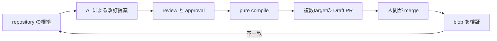

# RuleBranch 設計ガイド

## 結論

RuleBranch は、リポジトリに散在する開発ルールを「根拠を持つ変更可能な資産」として管理し、
陳腐化の検出から更新提案、承認、各 AI ツール向け設定の Draft PR、merge 後の検証までを一続きにする。
AI は候補と引用箇所を提案し、コードが repository から根拠を再取得して検証する。
状態遷移と公開は権限、transaction、決定論的 compiler で制御する。

## 2分で読む順番

| 時間 | 読むもの | 分かること |
|---:|---|---|
| 15秒 | [01 プロダクト概要](./01-product-overview.md) | 誰の、どの損失を減らすか |
| 20秒 | [02 システム構成](./02-system-architecture.md) | Web、Worker、GitHub、GCP の責任分界 |
| 15秒 | [03 データフロー](./03-data-flow.md) | 操作から非同期処理、公開確認までの流れ |
| 15秒 | [04 データモデル](./04-data-model.md) | 根拠、版、決定、生成物をどう結ぶか |
| 15秒 | [05 ルールのライフサイクル](./05-rule-lifecycle.md) | proposed / approved / stale の意味 |
| 15秒 | [06 AI の信頼境界とセキュリティ](./06-ai-trust-and-security.md) | AI をどこまで信用し、どこで止めるか |
| 15秒 | [07 信頼性と設計判断](./07-reliability-and-decisions.md) | retry、冪等性、整合性の設計判断 |
| 10秒 | [08 デモと実装証拠](./08-demo-and-evidence.md) | 実装済みであることをどう確認するか |

## 設計文書の地図

| 文書 | 主語 | 中心となる問い |
|---|---|---|
| 01 | プロダクト | なぜ単なるルール一覧では足りないか |
| 02 | 実行基盤 | どのコンポーネントが何を所有するか |
| 03 | request / job | 同期と非同期がどうつながるか |
| 04 | データ | 履歴と証跡をどう失わないか |
| 05 | RuleVersion | 誰がいつ状態を変えられるか |
| 06 | 信頼境界 | 非信頼入力と AI 出力をどう閉じ込めるか |
| 07 | 障害 | 二重配送、途中失敗、競合からどう復旧するか |
| 08 | 審査 | 何を見れば主張を検証できるか |

## 評価時に押さえる4点

1. ルール本文だけでなく、evidence、drift finding、approval、decision memory、artifact をつなぐ。
2. AI の文章生成と、承認・コンパイル・公開という権限を分離する。
3. 一つの承認済みルール集合から複数 AI ツール向けファイルを決定論的に生成する。
4. PR 作成で終了せず、merge 後の Git blob を照合し、差異を次の drift として戻す。

## 人間が関与する地点

| 地点 | 通常の判断 |
|---|---|
| 初回ルール採用 | 人間が内容と適用範囲を確認する |
| Drift finding の accept | 人間が「修正対象として扱う」と決める |
| RuleVersion の approval | 通常は人間。限定条件下のみ任意の自動承認が可能 |
| Draft PR の merge | GitHub 上で人間が merge する |

自動承認は manual が既定で、明示した Workspace、AI データ利用同意、L3、
clarify/refactor などの狭い条件と複数の fail-closed gate を満たす場合だけ有効になる。
自動承認されても GitHub 反映は Draft PR であり、人間の merge を越えない。

## 用語上の注意

Project の `active` はプロジェクトが処理対象として有効であることを示す。
Rule の `stale` は、承認済みルールが現在のコードや依存関係とずれた可能性を示す。
両者は別の軸であり、active Project の中に stale Rule が存在できる。

ADK は依存関係として含まれるが、実行経路を ADK Runner が統括しているわけではない。
実装は `google-genai` と用途別の専用エージェント／ハンドラを組み合わせる。
AI provider 設定は `gemini-api` と `vertex-ai` を扱えるが、現在の本番値はコードだけから断定しない。

## 実装への入口

- Web runtime: [bootstrap.ts](../../apps/web/src/server/bootstrap.ts)
- Worker runtime: [main.py](../../apps/worker/src/rulebranch/main.py)
- 非同期 job: [job_runtime.py](../../apps/worker/src/rulebranch/job_runtime.py)
- AI 読み取り境界: [ai_runtime.py](../../apps/worker/src/rulebranch/ai_runtime.py)
- 決定論的 compiler: [compiler.py](../../apps/worker/src/rulebranch/compiler.py)
- GitHub 公開: [github_publisher.py](../../apps/worker/src/rulebranch/github_publisher.py)
- merge 後検証: [publish_verify.py](../../apps/worker/src/rulebranch/publish_verify.py)
- 任意の自動承認: [automatic-approval.ts](../../apps/web/src/shared/automatic-approval.ts)
- GCP 構成: [main.tf](../../infra/main.tf)、[approval.tf](../../infra/approval.tf)

## 信頼性の保証範囲

- HTTP timeout だけを処理停止の証明にしない。アプリ deadline、attempt owner fence、compile lease を併用する。
- 集約 instruction の不一致も公開 snapshot 内のルールへ関連付ける。whole-file 比較なので手編集領域だけの変更も検出する。
- pure compiler の決定性と、保存 snapshot 単独からの履歴再現は別であり、後者は現状保証しない。
- 手編集の保護対象は共有 instruction の管理ブロック外。管理ブロック内は生成物として置換する。

## 限界

- GitHub App と Google Cloud に依存するため、外部障害時は retry または人間確認が必要になる。
- AI の判断品質を完全保証せず、根拠不足、入力超過、評価 API 異常は承認へ進めない。
- 自動承認は汎用ワークフローではなく、低リスクな保守更新に限定した任意機能である。
- UI の表示だけを証跡とせず、Firestore の状態、audit log、GitHub blob の検証を正とする。
