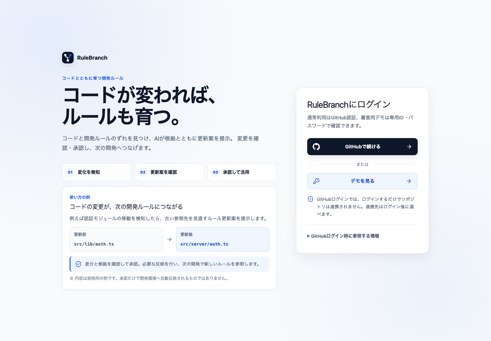
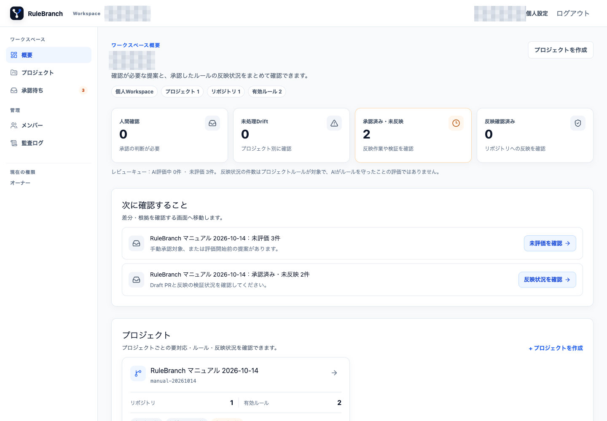
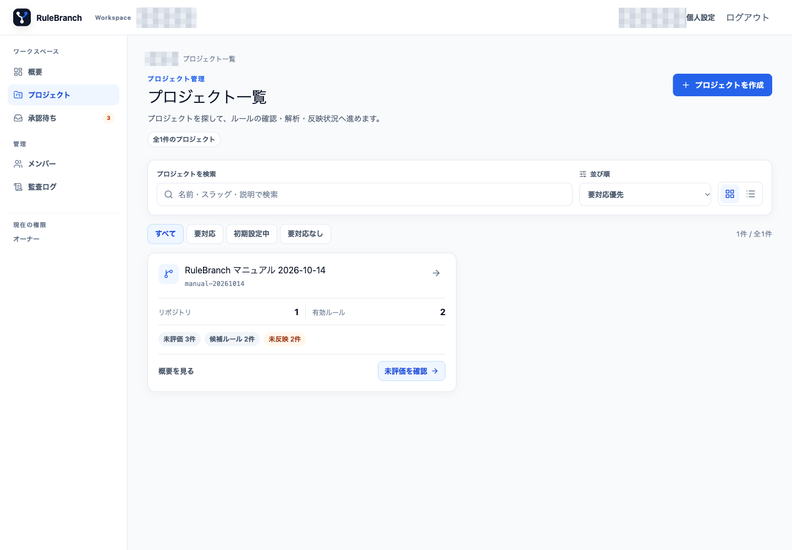
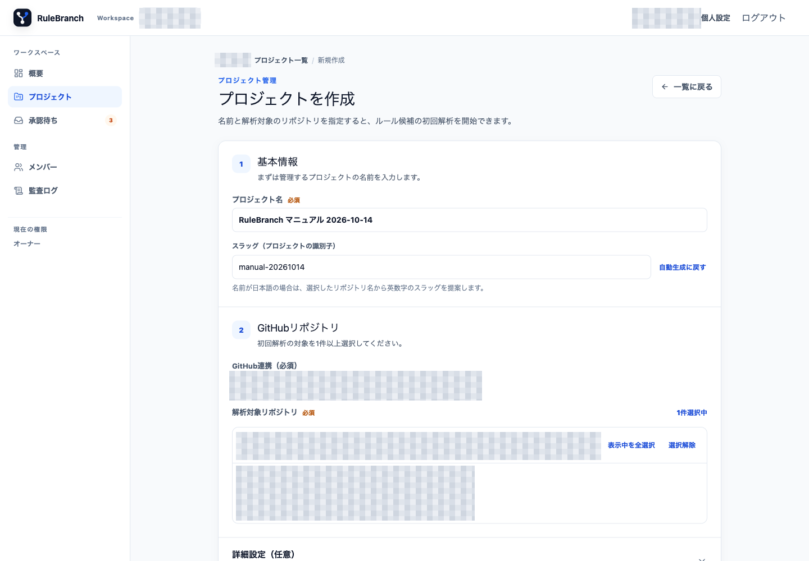
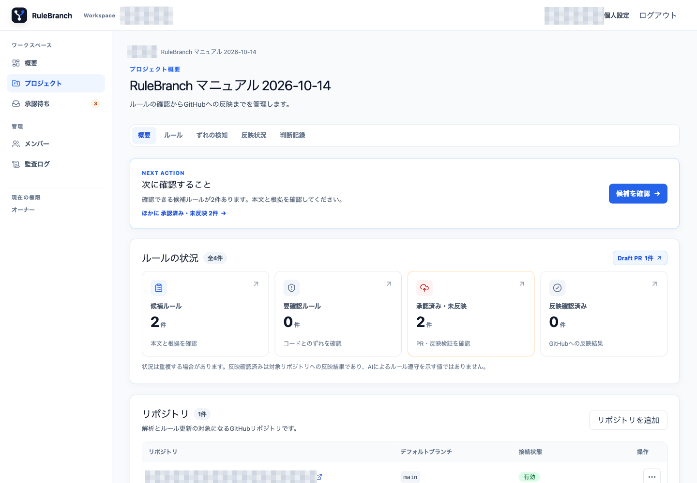
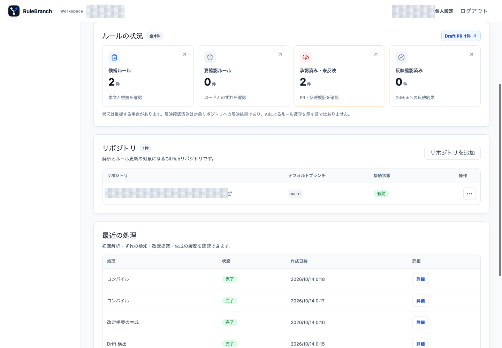
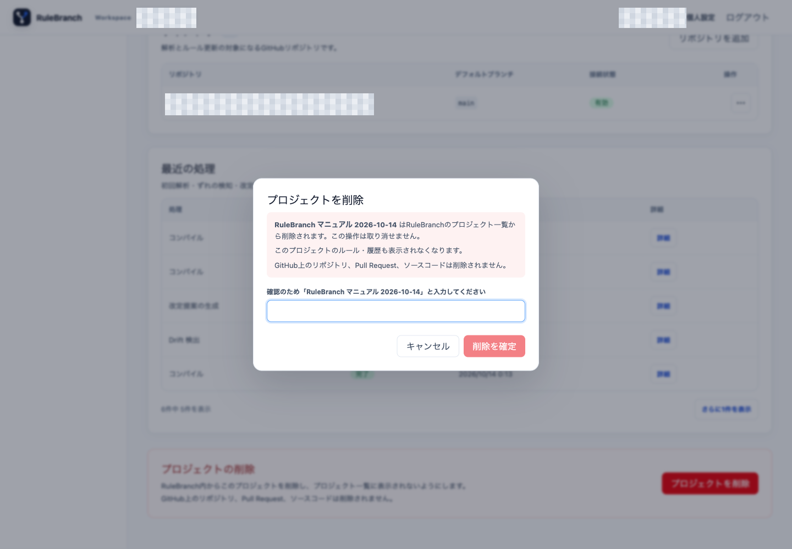

# 01. ログイン、Workspace、Project

## 1.1 GitHub でログインする

1. 未ログインで RuleBranch を開きます。
2. 「GitHubで続ける」を押します。
3. GitHub OAuth を完了します。

保護された画面の URL からログインした場合は、ログイン後に元の画面へ戻ります。

「ログイン時に参照する情報」を開くと、GitHub プロフィール用の `read:user` とメールアドレス用の `user:email` を確認できます。ログインだけではリポジトリは連携されません。連携先はログイン後に選びます。

## 1.2 Workspace の概要を確認する

ログイン後は Workspace の「概要」が入口です。上部の Workspace 切替から、参加している Workspace を切り替えられます。画面には Project、リポジトリ、有効ルールの集計と、対応が必要なレビュー、Drift、未反映ルールが表示されます。

初回セットアップ中は、次の進行状況が表示されます。

1. Workspaceを作成
2. GitHub Appを接続
3. プロジェクトを作成
4. リポジトリを追加
5. 初回解析を確認

個人 Workspace はオーナー一名で使います。組織 Workspace のメンバーと権限は[第8章](./08-members-settings-audit.md)を参照してください。

## 1.3 GitHub App を接続する

初回案内の「GitHub Appを接続」、または Workspace 内の接続画面を開きます。「必要な権限」を確認し、「GitHubでインストール」を押してください。GitHub 側では解析対象にしてよいリポジトリだけを選びます。

GitHub App のインストールだけでは Project は作成されません。RuleBranch に戻り、次の手順で Project と解析対象リポジトリを結び付けます。

## 1.4 Project を作成する

左ナビゲーションの「プロジェクト」を開くと、Project の一覧、検索、作成導線を確認できます。

1. 「プロジェクトを作成」を押します。
2. 基本情報として名前とスラッグを入力します。
3. GitHub App のインストールと解析対象リポジトリを選びます。この選択は必須です。
4. 必要に応じて「詳細設定（任意）」へ説明、技術スタック、AI Companionへの補足指示を入力します。
5. 入力内容を確認して作成します。

- 名前: 利用者に分かる名称
- スラッグ: URL や識別に使う一意の文字列
- GitHub リポジトリ: GitHub App のインストールと解析対象リポジトリ
- 詳細設定（任意）: 説明、主要言語、フレームワーク、注目テーマなどの技術スタック
- AI Companionへの補足指示（任意）: この Project で提案時に考慮してほしい条件

「GitHubリポジトリ」ではリポジトリ名で検索でき、複数選択も可能です。その下にある「詳細設定（任意）」は、必要な場合だけ入力します。

作成すると初回解析が開始されます。ジョブの状態は「待機中」「実行中」「完了」の順に進みます。「待機中」や「実行中」は解析完了ではありません。「完了」と抽出された候補を確認してください。失敗時は Project 概要のジョブ詳細にエラーが表示されます。

掲載画面の確認では、専用の Project と検証用 Repository を連携し、初回解析後にルール候補が表示されるところまで観測しました。Project 名、Repository 名、内部 ID、候補件数は公開版では省略しています。この観測は現在の環境で同じ結果になることを保証しません。

同じスラッグが既に存在する場合は、入力を保持したまま「このスラッグは既に使われています。別の文字列を指定してください。」と表示されます。

## 1.5 Project 概要を使う

Project card を開くと「概要」が表示されます。Project 内のナビゲーションは「概要」「ルール」「ずれの検知」「反映状況」「判断記録」です。

概要では次を確認できます。

- 次に確認すること
- ルールの状態別集計
- 連携中のリポジトリ
- 初回解析など最近の処理
- Project の技術・テーマ情報

リポジトリ欄では、full name、default branch、連携状態を確認できます。

管理権限がある場合は「リポジトリを追加」を押し、「GitHub Appのインストール」と「リポジトリ」を選びます。既に連携済みのリポジトリは重複して追加されません。目的のリポジトリがない場合は「連携設定を確認」から GitHub App の設定を見直します。

管理者または Owner は概要下部の「プロジェクトの削除」から Project を削除できます。確認欄へ Project 名を正確に入力して「削除を確定」を押します。これは RuleBranch 内での論理削除で、Project と関連するルール・履歴は一覧や詳細から見えなくなりますが、GitHub の Repository、Pull Request、ソースコードは削除しません。実行中のジョブまたは compile がある場合は `PROJECT_BUSY` となるため、完了後に再実行してください。削除後は同じスラッグで Project を再作成できます。削除済み Project を画面から復元する機能はありません。

今回の確認では削除ダイアログを開き、Project 名を入力せずにキャンセルしました。専用 Project は削除せず、そのまま保持しています。

## 1.6 権限とエラー

- Project 作成とリポジトリ管理は、組織 Workspace では管理者以上が行います。
- 閲覧者は概要、リポジトリ、ジョブを確認できますが、追加・解除操作はできません。
- 参加していない Workspace の URL を直接開いても、その Workspace のデータは表示されません。
- GitHub App や Worker が正しく接続されていない場合、解析ジョブが待機中のままになることがあります。ジョブ ID と状態を記録し、[第9章](./09-daily-operation-and-troubleshooting.md)を参照してください。

組織の権限境界は掲載画面の個人 Workspace では実行しておらず、公開されている権限実装に基づく説明です。
