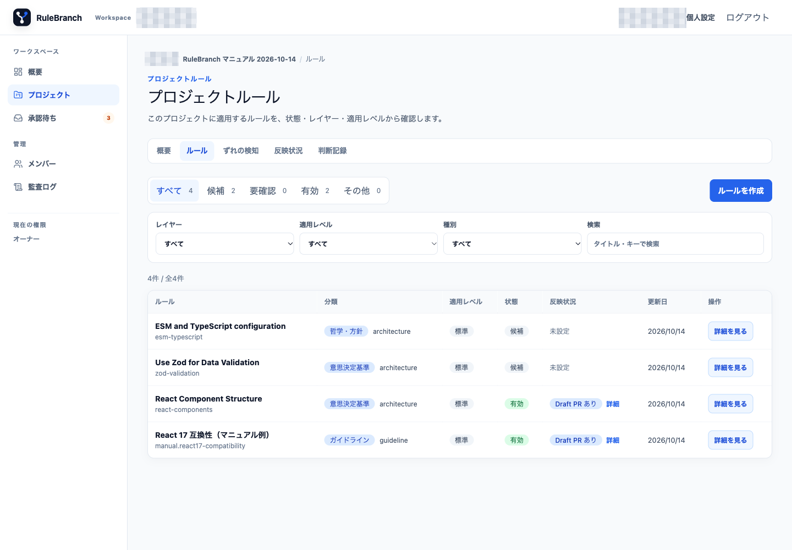
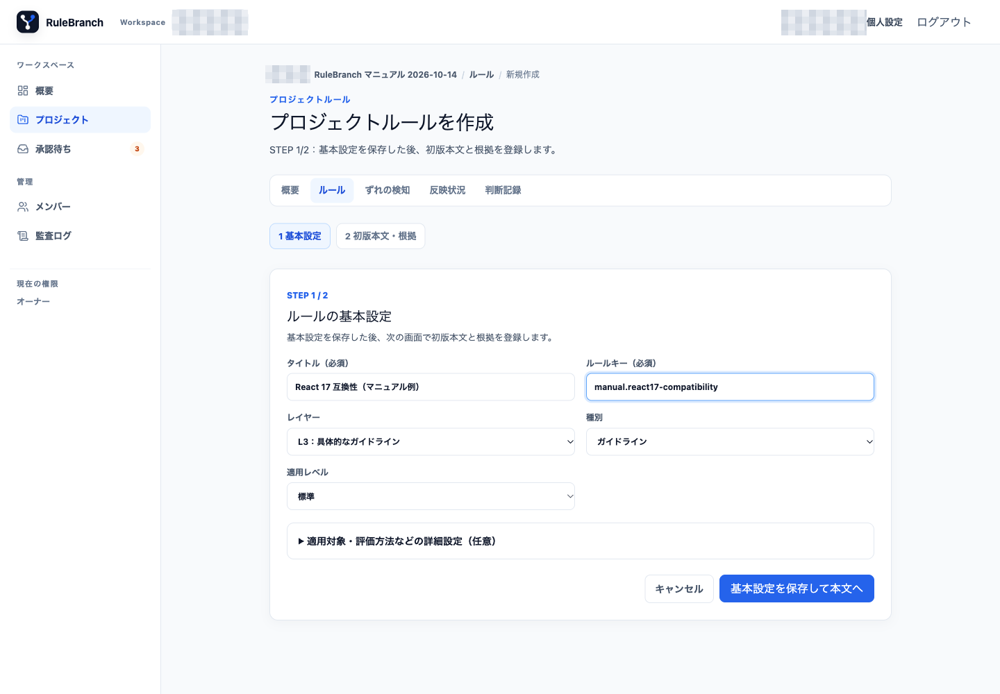
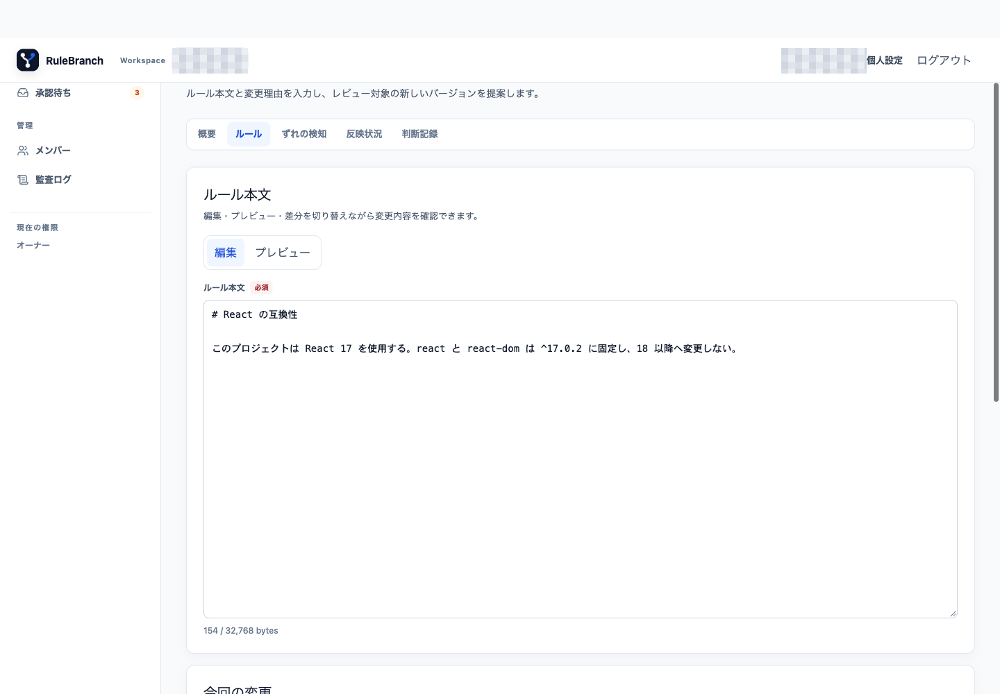
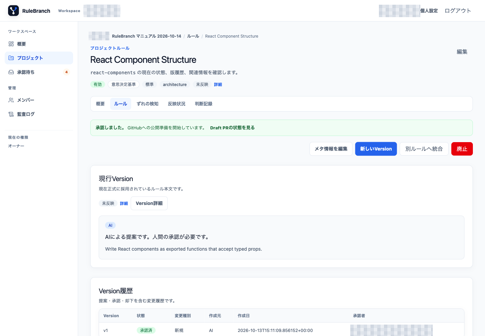
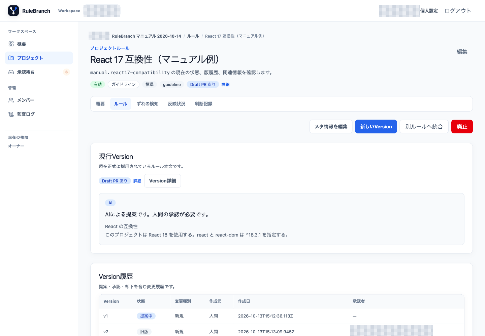
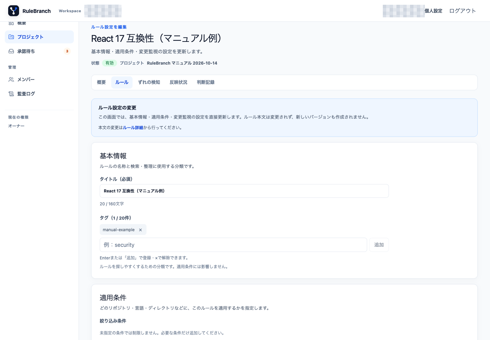

# 02. ルールの考え方と作成・編集

## 2.1 L1、L2、L3 を使い分ける

RuleBranch は開発ルールを三つのレイヤーで整理します。

| レイヤー | 画面表示 | 用途の例 |
|---|---|---|
| L1 | 哲学・方針 | 安全性、品質、判断の最上位原則 |
| L2 | 意思決定基準 | 境界設計、技術選定、例外を認める条件 |
| L3 | 具体的なガイドライン | コーディング、テスト、レビューの具体的手順 |

L1 は長く保つ原則、L2 は選択時の判断軸、L3 は日々の実装に近い指示として書くと、重複を減らせます。

ルールの種別は「ポリシー」「ガイドライン」「ワークフロー」「アーキテクチャ」「セキュリティ」「コーディングスタイル」「対話・コミュニケーション」の7種類です。

適用レベルは Project ルールでは「標準」「推奨」、組織ルールではさらに「必須（組織）」を選択できます。「必須（組織）」は下位 Project から置換や不適用にできない強いルールです。

## 2.2 ルール一覧を読む

Project の「ルール」を開くと、レイヤー、状態、適用レベルなどでルールを確認できます。

Rule の主な状態は次のとおりです。

| 状態 | 意味 |
|---|---|
| 候補 | 初版や候補 Version がまだ承認されていない |
| 有効 | 承認済みの現行 Version がある |
| 要確認 | コードとのずれなどにより見直しが必要 |
| 統合済 | 別ルールへ統合された |
| 廃止 | 利用を終えた |
| アーカイブ | 通常運用から退避された |

## 2.3 ルールを作成する

Project の「ルールを作成」を押します。作成は基本設定と初版 Version の2段階です。

最初の画面で次を設定します。

- `タイトル（必須）`: 何を判断するルールかが分かる名称
- `ルールキー（必須）`: 小文字英数字で開始し、英数字、ピリオド、ハイフン、アンダースコアを使う100文字以内のキー
- `レイヤー`: L1、L2、L3
- `種別`: 7種類から選択
- `適用レベル`: 標準または推奨

「適用対象・評価方法などの詳細設定（任意）」では、次を指定できます。

- 評価方法: `決定的チェック`、`意味評価`、`ハイブリッド`
- 対象リポジトリ: Project の全リポジトリ、または指定したリポジトリ
- 対象言語、対象フレームワーク、対象ディレクトリ、適用条件に使う依存関係
- タグ
- 変更を監視する依存関係

指定リポジトリ方式を選んだ場合は、1件以上を選ぶ必要があります。決定的チェックは JSON 配列で1件以上のチェック定義が必要です。意味評価ではチェック定義は保存対象になりません。ハイブリッドはチェックを空にすると意味評価のみで動作します。

「基本設定を保存して本文へ」を押すと `STEP 1 / 2 完了` が表示されます。「初版本文を登録する」へ進みます。

## 2.4 初版 Version を登録する

Version 作成画面で、Markdown のルール本文、変更理由、変更種別を入力します。

変更種別は「新規」「明確化」「強化」「緩和」「整理」「廃止」です。詳細設定では互換性情報を JSON で記録し、既存の Evidence ID がある場合は根拠を関連付けられます。

本文は「編集」「プレビュー」で確認します。元 Version や現行 Version がある場合は差分表示も使えます。「Versionを作成」を押すと初版は「提案中」になり、承認されるまで「有効」にはなりません。

## 2.5 selector と監視対象

selector は、そのルールをどこに適用するかを記録します。

- リポジトリを限定すると、その Repository の生成対象にできます。
- 言語、フレームワーク、directory glob、dependency は適用条件のメタデータです。
- `変更を監視する依存関係` は、`package.json` の依存変更を Drift として検出するために使います。

Repository を限定する場合は対象リポジトリの選択を使います。言語、フレームワーク、directory glob、dependency は、現在は適用条件の記録として扱われます。

## 2.6 詳細とメタ情報を確認する

ルール詳細では基本情報、selector、現行 Version、Version 履歴を確認できます。次は L2 と L3 の実例です。

「メタ情報を編集」を押すと、見出し「ルール設定を編集」の画面が開きます。

タイトル、分類、selector、タグ、監視対象を変更できます。適用リポジトリを限定状態から全体へ広げる場合は、適用範囲が広がることを確認して保存します。大文字小文字だけが違う言語タグは重複を避けて正規化されます。

メタ情報を編集しても、過去の Version 本文は変更されません。本文を変更する場合は「新しいVersion」または Version 詳細の「修正版を作成」を使います。未保存のままキャンセルまたは移動すると「未保存の変更を破棄して移動しますか？」と確認されます。

掲載画面では、検証用 Project にルールと改定案が表示され、本文、差分、根拠を確認して承認する流れを観測しました。実際の Project 名、版番号、Repository の内容は公開版では省略しています。メタ情報の編集画面は入力内容を確認し、保存せずに閉じました。

## 2.7 組織ルール

組織 Workspace では左ナビゲーションの「組織ルール」から作成します。Project ルールと違い、Repository 選択 UI はありません。L1 の「必須（組織）」を含め、複数 Project に共通する原則を定義できます。

個人 Workspace では「組織ルール」ナビゲーションは表示されません。この節は公開 source と[データモデル](../design/04-data-model.md)に基づく説明で、掲載画面の環境では作成・承認していません。
