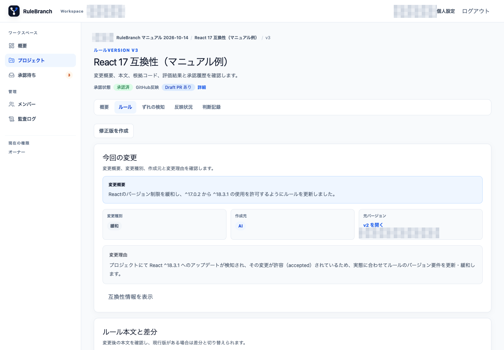
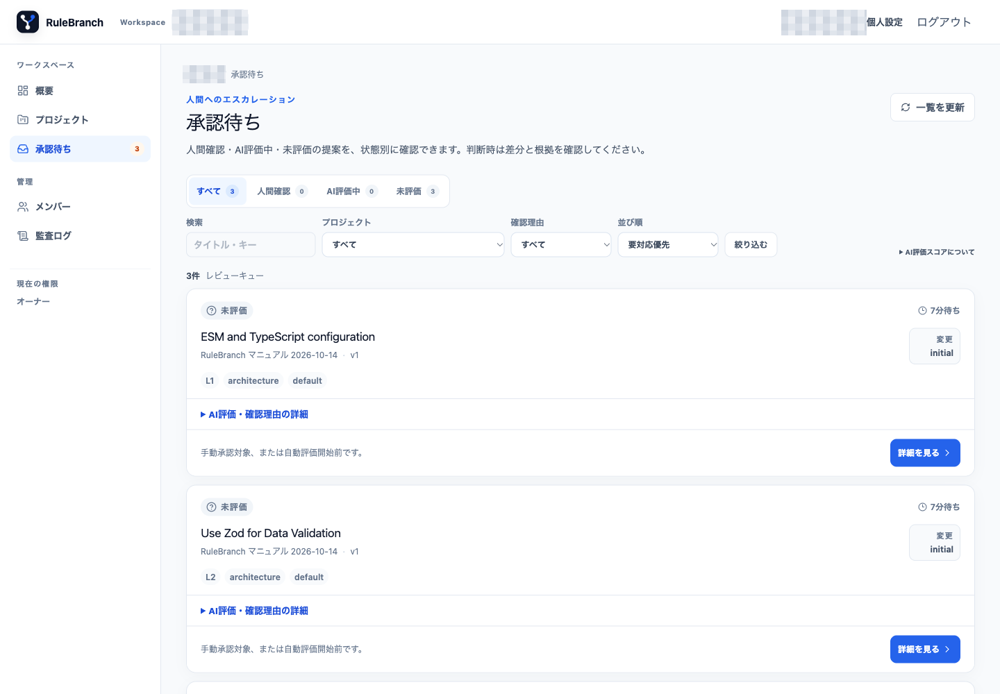
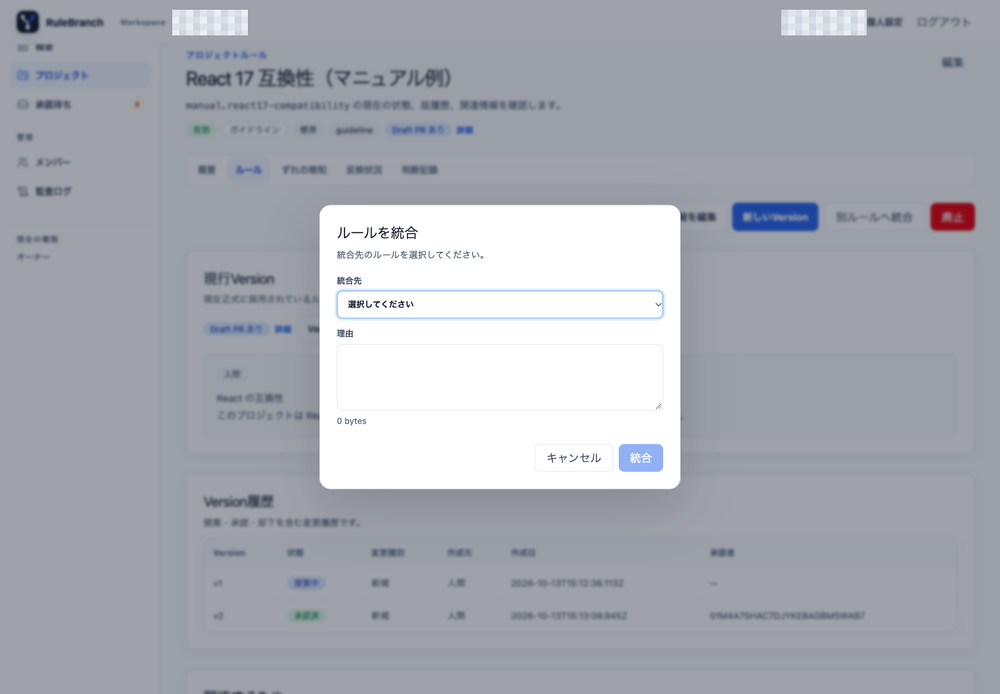
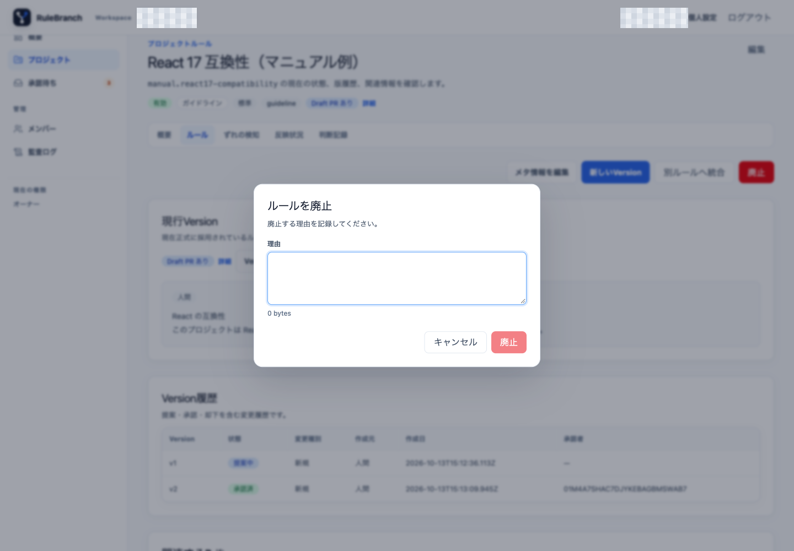

# 03. Version のレビューとライフサイクル

## 3.1 Version 詳細を確認する

ルール詳細の Version 履歴から `vN` を開きます。Version 詳細には次の情報があります。

- 承認状態と GitHub 反映状態
- 今回の変更、変更種別、作成元、元バージョン、変更理由
- 現行版との差分と変更後の全文
- 判断の根拠となる Evidence と対象 commit
- 自動評価・承認判定
- 関連する Drift
- レビュー記録

作成元は「人間」「AI」「システム（決定的処理）」などで表示されます。AI の提案でも、本文、差分、根拠コード、自動評価を確認してから判断してください。

## 3.2 承認する

提案中 Version で「承認」を押し、必要に応じて承認コメントを入力します。承認後、その Version が現行版になり、Rule は初回なら「有効」になります。承認時には「判断記録」も作成されます。

承認はルール内容を採用する操作です。GitHub への反映完了ではありません。反映には Draft PR の作成、人間によるマージ、マージ後の検証が必要です。

掲載画面では、manifest と対象 revision を根拠に生成された改定案をレビューし、コメントを付けて承認する流れを観測しました。実 Repository の commit と版番号は公開版では省略しています。

権限は次のとおりです。

- 個人 Workspace: オーナー
- 組織 Workspace の Project ルール（標準・推奨）: メンテナー以上
- 組織ルール、または必須（組織）: 管理者以上

組織ロールの境界は掲載画面の環境では実行しておらず、公開されている権限実装に基づきます。

## 3.3 却下する

提案中 Version の「却下」を押し、理由を入力します。理由は必須です。却下すると Version は「却下」になりますが、Rule 自体はアーカイブされず、現在有効な Version も変わりません。レビュー記録には却下理由が残ります。

初回候補を Rule ごと採用しない場合は、候補レビューの `却下(アーカイブ)` を使います。これは `この版のみ却下` と異なり、候補 Rule をアーカイブし、その Rule の提案中 Version を自動的に却下します。

## 3.4 修正版または新しい提案を作る

Version 詳細の「修正版を作成」は、開いた Version の状態によって意味が異なります。

### 提案中 Version から修正する

提案中 Version から開くと、その提案を置き換える修正版です。送信に成功すると新しい Version が「提案中」になり、元の提案は「取下げ」になります。承認済みの現行 Version は、新しい提案が承認されるまで変わりません。

別のタブで元提案が先に却下・変更されていた場合、新しい Version の作成は拒否され、「元の提案が変更されています」という案内が出ます。入力内容は保持されるため、最新状態を確認してやり直してください。

### 承認済み・却下済みなどの Version を元にする

提案中以外の Version から開くと、その内容をコピーして新しい提案を作ります。元の承認済み Version を取下げる操作ではありません。新しい提案が承認されるまで現行版は元の承認済み Version のままです。

Version 作成画面では「修正元のバージョン」、本文、変更理由を確認し、必要な差分だけを編集します。

## 3.5 取下げる

人間が作成した提案中 Version は、作成者本人だけが「取下げ」を実行できます。取下げ後も現行 Version は変わりません。AI 提案には公開の取下げ操作を表示しません。AI 提案を直す場合は「修正版を作成」を使います。

## 3.6 Workspace の承認待ちを使う

左ナビゲーションの「承認待ち」には、Workspace 内の提案が集約されます。

上部のタブで「すべて」「人間確認」「AI評価中」「未評価」を切り替えられます。さらに次を組み合わせられます。

- タイトル・キーの検索
- Project
- 確認理由
- 並び順: 要対応優先、古い順、新しい順

「一覧を更新」を押しても現在の絞り込みは維持されます。「リセット」で初期条件へ戻ります。項目を開き、Version 詳細で本文、差分、根拠、評価結果を確認してください。

今回の画面ではタブ、検索、Project、並び順、Version リンクを確認しました。複数の確認理由を持つ専用データがなかったため、確認理由の全選択肢は新たに実行していません。

## 3.7 Rule の統合、廃止、アーカイブ、復活

有効または要確認の Rule は、用途に応じて次の状態へ移せます。

- `別ルールへ統合`: 同じスコープの有効な Rule を統合先に選び、理由を記録する
- `廃止`: 廃止理由を記録して「廃止」にする
- `アーカイブ`: 統合済みまたは廃止済みの Rule を通常運用から退避する
- `復活`: 管理者以上が提案中 Version を選び、承認して「有効」に戻す

「別ルールへ統合」では統合先と理由を確認し、共有データに影響する場合は確定前にキャンセルできます。

「廃止」は理由がないと確定できません。

統合先には自分自身、別スコープ、無効な Rule を選べません。候補 Rule を直接アーカイブすると提案中 Version も却下されるため、保持したい提案がある場合は先に処理方針を決めてください。

掲載画面の確認では統合・廃止ダイアログを開き、永続変更の直前でキャンセルしました。復活、確定後の統合・廃止・アーカイブ、組織ロールの比較は、この画面観測には含まれません。状態遷移の実装は[ルールのライフサイクル](../design/05-rule-lifecycle.md)を参照してください。
