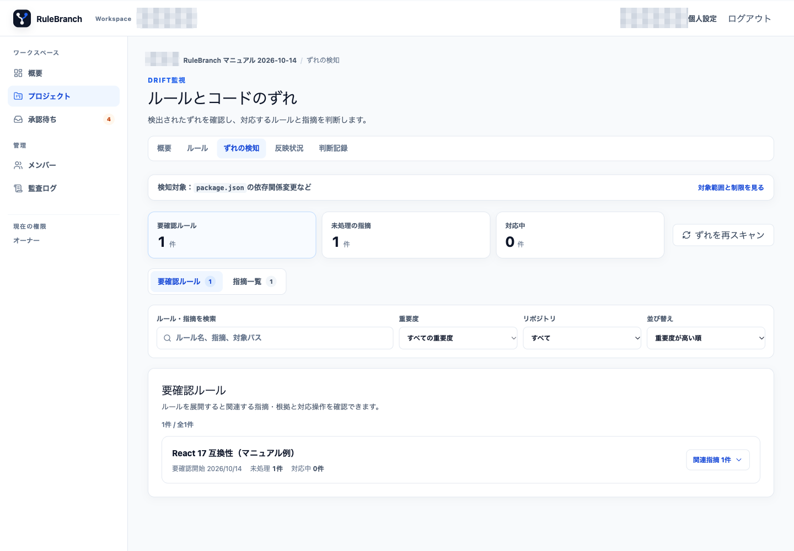
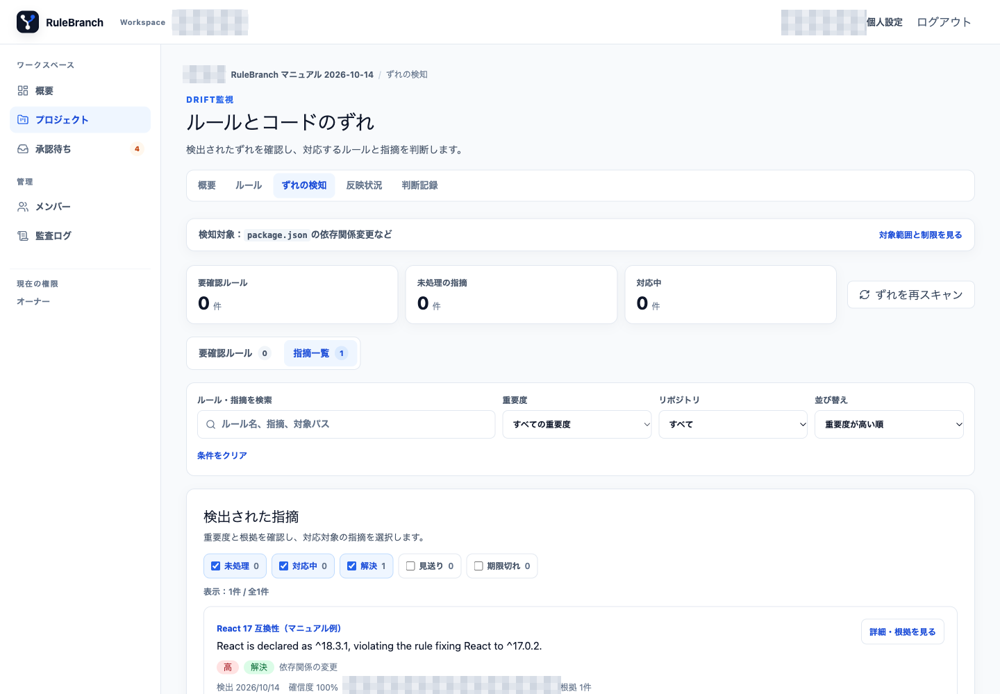
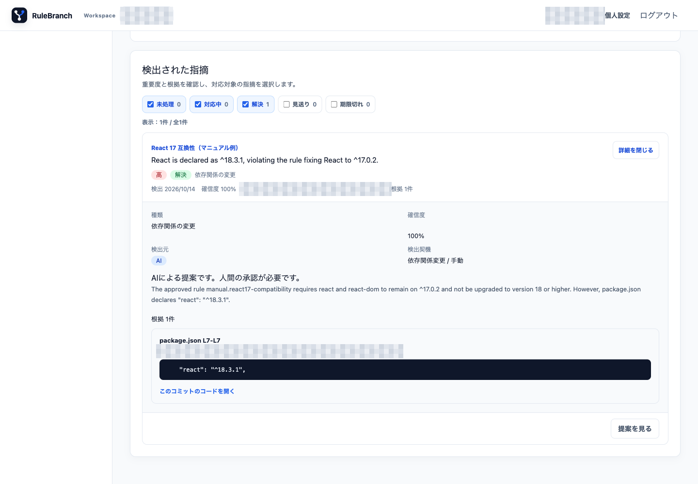

# 05. ずれの検知と改定提案

RuleBranch の Drift は、コードや依存関係の状態と、承認済みルールの内容とのずれを示します。2026年10月14日の確認では、React 17 を使用すると定めたルールと、リポジトリで実際に使用している React 18.3.1 の矛盾を手動スキャンで検出しました。

## 一覧を確認する

1. プロジェクトを開き、上部の「ずれの検知」を選びます。
2. 「要確認ルール」と「指摘一覧」を切り替えます。
3. 検索、重要度、リポジトリ、並び替えで対象を絞ります。
4. 「指摘一覧」では「未処理」「対応中」「解決」「見送り」「期限切れ」を必要に応じて選びます。選択内容は URL に反映されます。
5. カードの「詳細・根拠を見る」を開き、検出元のファイル、行、commit、確信度を確認します。

掲載画面では、承認済みルールと manifest の依存バージョンが一致しない例が、重要度、確信度、対象ファイルの Evidence とともに表示されました。実 Repository の commit、依存バージョン、件数は公開版では省略しています。これは画面観測であり、任意の Repository で同じ指摘が生成されることを保証しません。

## 指摘を判断する

未処理の指摘では、根拠を確認して次のいずれかを選びます。

- 対応する場合は「対応対象に追加」を選びます。状態は「対応中」になりますが、この時点ではルール更新も GitHub 反映も完了していません。
- 対応しない場合は「見送る」を選び、理由を入力します。理由は後から判断を追跡できる具体的な内容にします。
- 見送り済みを再検討するときは「再オープン」を選びます。

掲載画面では、指摘を「対応対象に追加」して対応中へ変更する流れを観測しました。閲覧者は閲覧のみ、指摘の判断はメンテナー以上が対象です。

## 再スキャンする

「ずれを再スキャン」は、メンバー以上が接続済みリポジトリを対象に Drift scan job を開始する操作です。実行中は同じボタンが無効になり、完了後に一覧が更新されます。リポジトリがないプロジェクトでは実行できません。

掲載画面では、オーナーが手動スキャンを開始し、job 完了後に指摘が表示される流れを観測しました。重複起動の抑止は公開 source の実装に含まれますが、この画面観測だけで競合時の動作を証明するものではありません。failed または dead と表示された場合は成功と判断せず、[日常運用とトラブルシューティング](09-daily-operation-and-troubleshooting.md)に従って確認してください。

## 提案を生成して承認する

対応中の指摘から提案を生成すると、Worker が新しい Rule Version を作成します。

1. 「提案を生成」を押し、job が完了するまで待ちます。
2. 「提案を見る」から Version を開き、本文差分、変更理由、作成元「AI」、Evidence、関連 Drift を確認します。
3. 内容を直す場合は「修正版を作成」で本文、変更理由、変更種別を入力します。新しい人間修正版が提案中になり、元の AI 提案は取下げになります。
4. 妥当であれば承認します。承認により現行 Version と判断記録が更新され、関連する指摘が解決します。
5. GitHub への反映は別工程です。「反映状況」で Draft PR とマージ後の検証を確認します。

掲載画面では、対応中にした指摘から AI 改定案を生成し、本文、差分、変更理由、Evidence、関連 Drift をレビューして承認する流れを観測しました。実際の条件、版番号、commit は公開版では省略しています。
