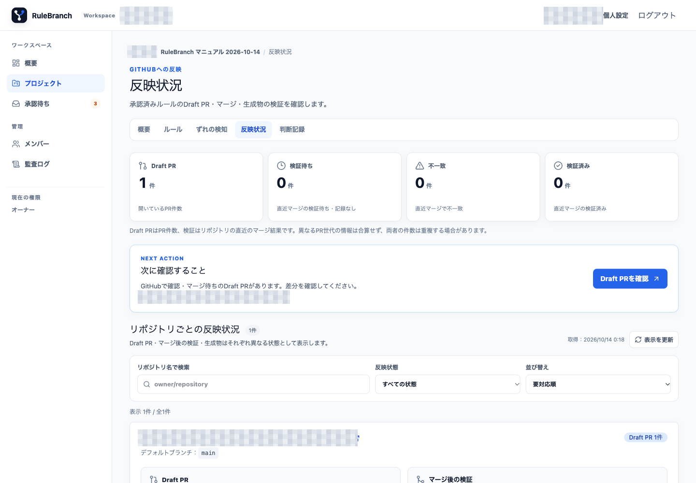

# 06. GitHub への反映

「承認済み」「生成処理完了」「Draft PR」「マージ済み」「検証済み」は別々の状態です。RuleBranch は生成物を Draft PR にまとめますが、自動ではマージしません。

## 反映状況を読む

プロジェクトの「反映状況」には、Draft PR、検証待ち、不一致、検証済みの件数と、リポジトリ別カードが表示されます。検索、反映状態、並び替えを組み合わせて対象を絞れます。「表示を更新」は RuleBranch が記録している最新の反映状態を再取得します。

掲載画面には、開いている Draft PR と反映状態の集計が表示されています。Draft PR は GitHub での確認・マージ待ちであり、反映検証が完了した状態ではありません。実 PR 番号と件数は公開版では省略しています。

## 生成物と履歴を確認する

リポジトリカードの次の項目を展開します。

- 「生成物」には保存済みの生成ファイル、path、技術情報が表示されます。
- 「PR履歴」には Draft、マージ済みなどの履歴が表示されます。
- 「生成ファイルの作成・再作成」には実行ボタンと、自動マージしない旨の注意が表示されます。

生成物と PR 履歴には Repository 固有の path、PR 番号、branch が含まれるため、この公開マニュアルでは実画面を掲載していません。利用中の環境で対象 Repository と内容を照合してください。

## Draft PR を作成・更新する

1. 対象リポジトリカードで「生成ファイルの作成・再作成」を開きます。
2. 「生成ファイルを作成・更新」を押します。
3. 確認ダイアログ「生成ファイルを作成・更新しますか？」で対象リポジトリを確認し、「GitHubへのマージは自動実行しません。」という注意を読みます。既存の Draft PR が更新される場合もあります。
4. 「生成を開始」を押して生成ジョブを開始します。
5. job が完了した後、カードを更新し、PR 番号、branch、生成物を確認します。job の done だけで PR 作成成功とは判断しません。
6. 「GitHubで差分を確認」を開き、承認済みルールと生成ファイルの差分が合うことを確認します。

生成処理が完了しても、Draft PR と保存済み生成物を個別に確認してください。実 PR 番号、branch、生成物の path や件数は公開版では扱いません。

## GitHub でレビューしてマージする

1. GitHub で Draft PR の差分を確認します。
2. 必要なレビューを行い、人間が Ready for review とマージを実行します。
3. RuleBranch に戻り、「表示を更新」を押します。
4. 「マージ後の検証」が「検証済」になり、「確認 commit」が GitHub のマージ後 commit と一致することを確認します。

掲載画面の Draft PR はマージせず、GitHub での確認・マージ待ちの状態を維持しました。マージ後の確認手順は[初回ルール配布](../usage/first-rule-publication.md)を参照してください。この手順書は実行成功の記録ではありません。

## 状態別の対応

| 表示 | 意味 | 対応 |
|---|---|---|
| Draft PR | GitHub での確認・マージ待ち | 差分をレビューする |
| 検証待ち・記録なし | マージ後の検証が未完了 | 少し待って「表示を更新」。続く場合は job と監査ログを確認 |
| 不一致 | default branch の生成物が期待内容と一致しない | 不一致 path を確認し、再生成して修復 PR をレビュー |
| 検証済み | GitHub 上の生成ファイルが一致 | 確認 commit と対象 PR を照合 |

「検証済み」は生成ファイルの整合性を示します。AI や開発者がルールを守ったことを測定する表示ではありません。複数リポジトリ対象の Version は、一部だけ検証済みなら一部反映、全対象で検証済みになって初めて反映確認済みになります。
