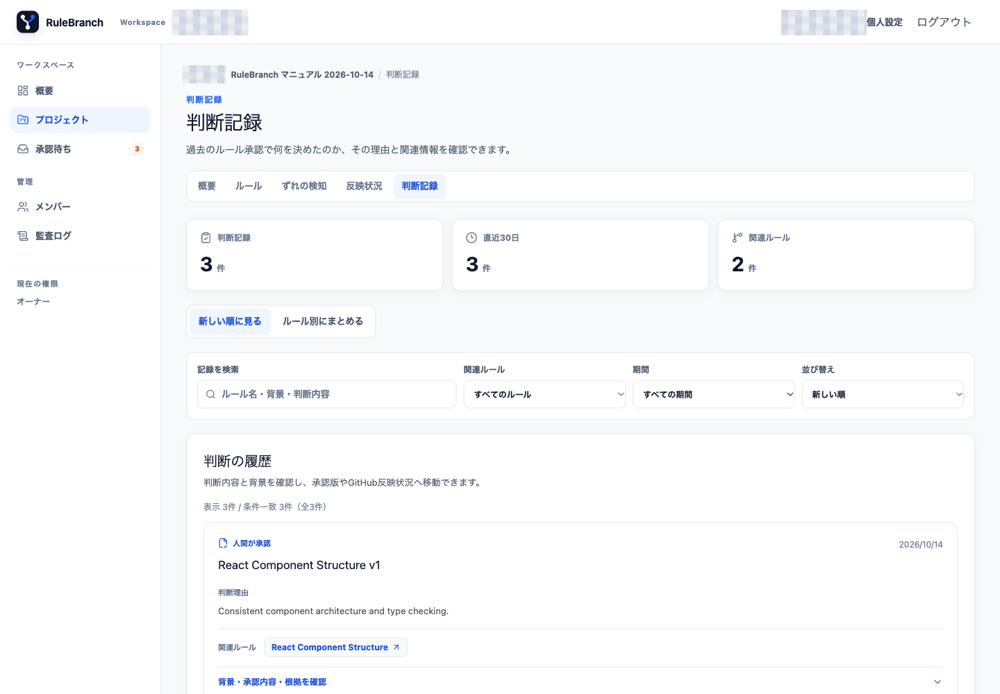
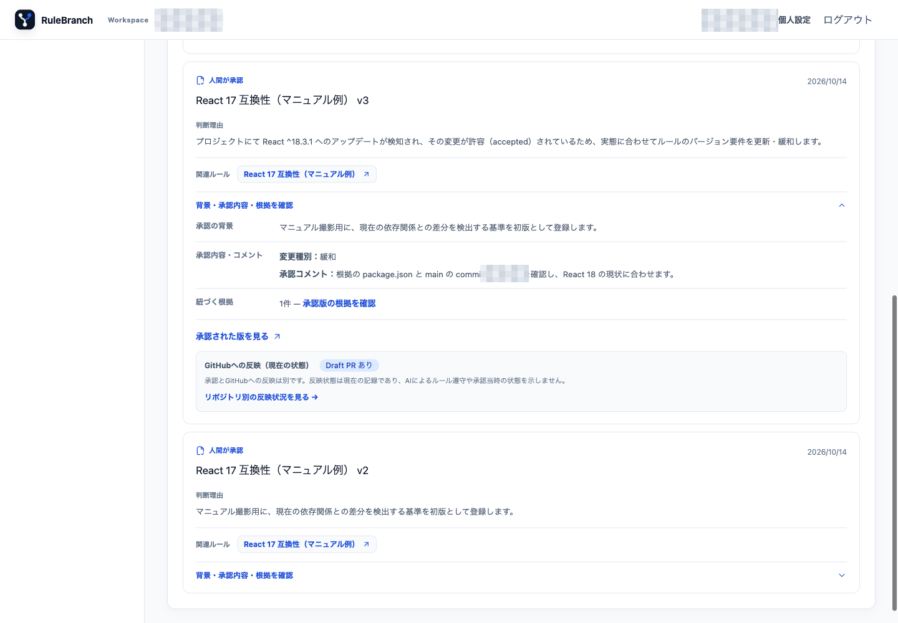

# 07. 判断記録

判断記録は、Rule Version を承認したときに自動生成される読取専用の記録です。手動の作成・編集・削除画面はありません。

## 記録を探す

1. プロジェクトの「判断記録」を開き、画面上部の総件数、直近30日、関連ルール数を確認します。
2. 「記録を検索」でルール名、背景、判断内容を検索します。
3. 「関連ルール」で一つのルールに絞ります。
4. 期間を直近7日、30日、90日、すべてから選びます。
5. 新しい順・古い順を選び、「新しい順に見る」と「ルール別にまとめる」を切り替えます。

## 判断の内容を確認する

1. 対象カードの「背景・承認内容・根拠を確認」を開きます。
2. 判断理由、承認の背景、変更種別、承認コメント、根拠を確認します。
3. 関連するルールと承認 Version が対象の判断と一致することを確認します。
4. 必要に応じて「承認された版を見る」または「リポジトリ別の反映状況を見る」を開きます。

「承認された版を見る」は、その判断を作った Version を開きます。古い判断記録から現在の Version へ勝手に置き換わることはありません。「リポジトリ別の反映状況を見る」は同じプロジェクトの反映状況へ移動します。

判断記録の存在は、GitHub への反映完了を意味しません。判断の根拠は Version、配布結果は「反映状況」でそれぞれ確認します。掲載画面では、判断理由、変更種別、承認コメント、Evidence、承認 Version へのリンク、GitHub 反映状態を確認できます。実 Project の件数、ルール名、版番号は公開版では省略しています。
