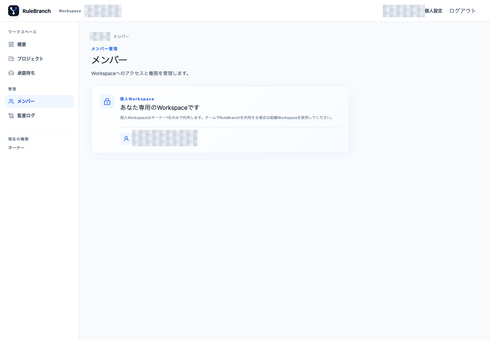
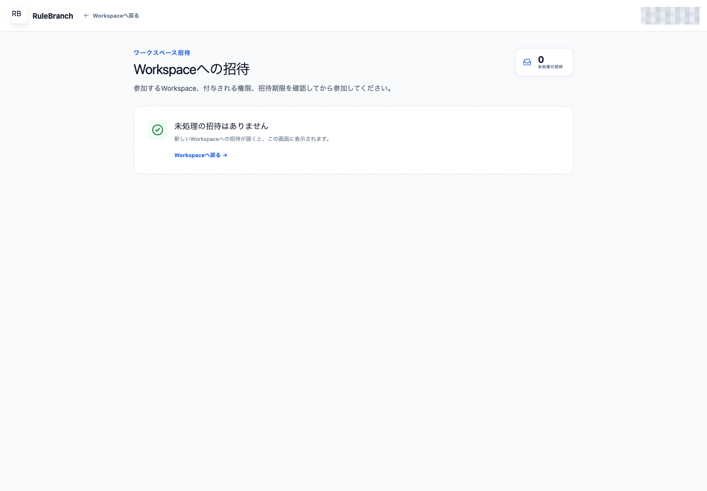
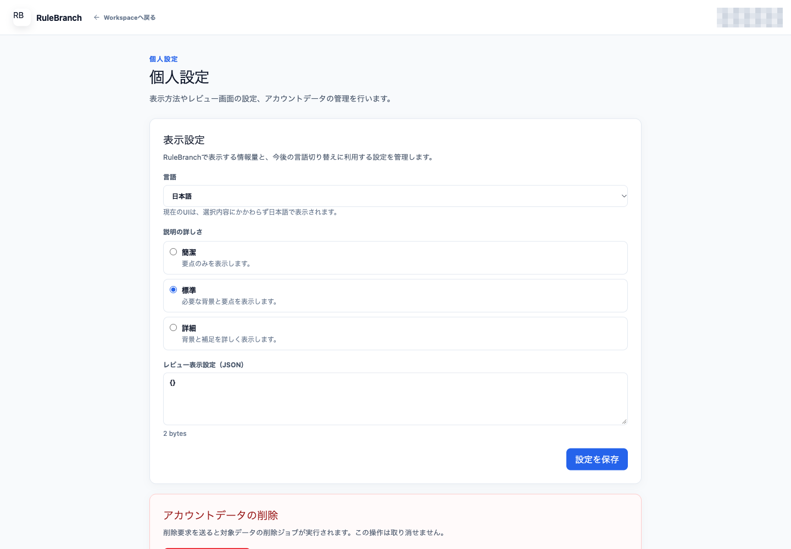
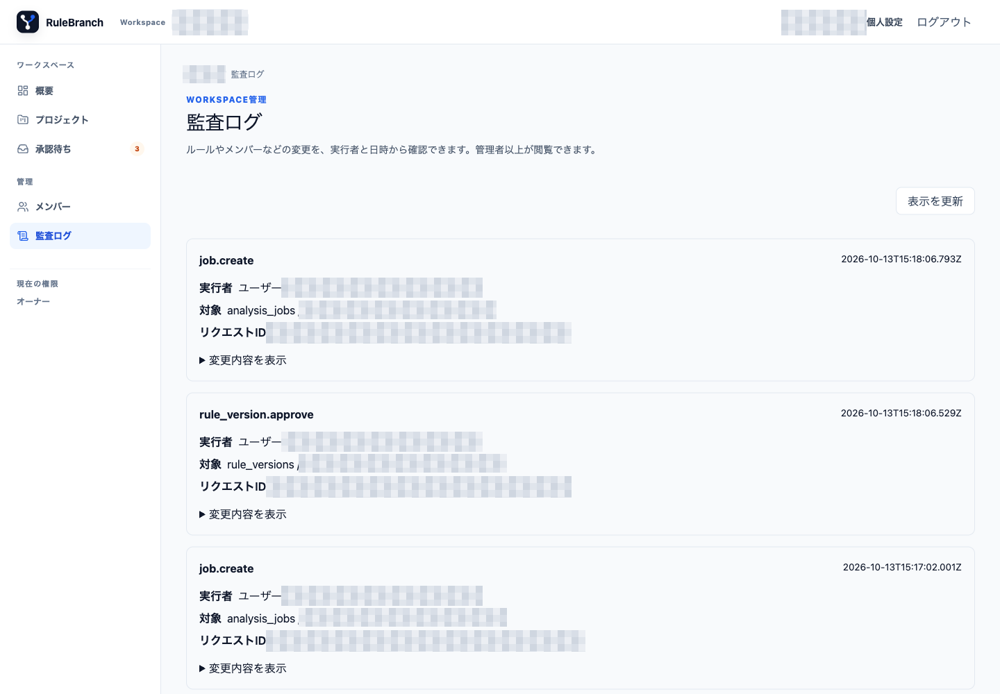

# 08. メンバー、個人設定、監査ログ

この章の管理操作には権限が必要です。個人 Workspace では招待を行いません。組織 Workspace のロール境界や招待は、組織の運用ルールに合わせて扱ってください。

## メンバーと招待

1. サイドバーの「メンバー」を開きます。
2. 参加中のメンバー、ロール、参加経路を確認します。
3. 組織 Workspace では保留中の招待も確認します。

組織 Workspace ではオーナーまたは権限を持つ管理者が「メンバーを招待」から GitHub ログイン名、ロール、メッセージを指定します。招待の取消、招待された本人による辞退または参加が可能です。オーナーは全ロールを管理でき、管理者が管理できるのはメンテナー、メンバー、閲覧者です。最後のオーナーは降格・除名できません。

撮影環境は個人 Workspace でオーナー本人一名だったため、招待送信、ロール変更、除名は実行していません。この節の組織 Workspace 操作は既存テスト仕様と実装に基づきます。

右上のユーザー名をクリックし、「Workspaceへの招待」画面を開くと、自分宛ての招待を確認できます。撮影時の未処理招待は 0 件でした。

## 個人設定

1. 右上の「個人設定」を開きます。
2. 言語と説明の詳しさを選びます。
3. 必要に応じてレビュー表示設定へ正しい JSON を入力します。
4. 「設定を保存」を押し、保存完了を確認します。

- 言語は日本語または English を選べます。現行 UI は locale を English にしても日本語表示のままです。
- 説明の詳しさは簡潔、標準、詳細から選びます。
- レビュー表示設定は正しい JSON を入力します。不正な JSON は「レビュー表示設定のJSONが正しくありません。」として保存前に拒否されます。

撮影時は既存設定 `ja`、`normal`、`{}` を閲覧しただけで変更していません。既存テストでは English、詳細、正常な JSON の保存と再読込、不正 JSON の拒否を確認後、元の設定へ復元済みです。

## 監査ログ

1. オーナーまたは管理者でサイドバーの「監査ログ」を開きます。
2. 操作の action、日時、実行者、対象、リクエスト ID を確認します。
3. 「変更内容を表示」で変更前後を展開します。
4. 50件を超える場合は「さらに読み込む」、最新状態を確認するときは「表示を更新」を押します。

監査ログは新しい順に最大50件を読み込み、「さらに読み込む」で次のページを追加します。「表示を更新」は先頭ページを再取得します。画面からログを編集・削除することはできません。保存期間を過ぎた payload は、変更内容が削除済みである旨を表示します。

掲載画面では、Project、Rule Version、Drift、生成 job に関する操作が監査ログに表示されることをオーナーで観測しました。実 Project 名、内部 ID、操作者の識別情報は公開版では省略しています。監査ログ自体の編集・削除と、別ロールとの権限比較は実行していません。

## 削除要求と GitHub App の解除

個人設定のデータ削除要求は、ログイン本人のアカウント全体に影響する不可逆の処理です。組織で唯一のオーナーである場合は受け付けられません。専用の使い捨てアカウントと運用手順がある場合だけ実行してください。

GitHub App のアンインストールは GitHub 側で行います。RuleBranch Web にアンインストール実行ボタンはありません。共有 installation の解除やアンインストールはリポジトリ接続と Workspace データに影響するため、撮影環境では実行していません。
